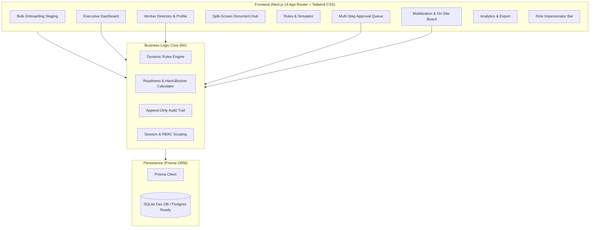

# Manpower Mobility Management System (MMS) Implementation Plan

> **For agentic workers:** REQUIRED SUB-SKILL: Use superpowers:subagent-driven-development to implement this plan task-by-task. Steps use checkbox (`- [ ]`) syntax for tracking.

**Goal:** Build and launch the complete Manpower Mobility Management System (MMS) MVP based on the PRD, UI/UX, ERD, API, and Technical Architecture documents, providing an end-to-end operational platform for workforce compliance, dynamic requirements, multi-step approvals, and mobilization tracking.

**Architecture:** A monolithic Next.js 14+ App Router (TypeScript) full-stack application using Prisma ORM with SQLite for zero-config local development (with full PostgreSQL production compatibility). The application features a dedicated business logic core (`rules-engine.ts`, `readiness-engine.ts`, `audit.ts`), a split-screen document verification hub, a dynamic rules simulator, and a developer role impersonator bar for seamless testing across all 7 enterprise roles.

**Architecture Diagram:**

**Tech Stack:** Next.js 14+, React 18, TypeScript, Tailwind CSS, Lucide React, Prisma ORM, SQLite (Dev) / PostgreSQL (Prod), XLSX (SheetJS) for spreadsheet import/export, jsPDF for PDF reports.

**Spec:** [docs/superpowers/specs/2026-09-21-mms-manpower-mobility-system-design.md](file:///e:/Project/Man%20Power/docs/superpowers/specs/2026-09-21-mms-manpower-mobility-system-design.md)

## Global Constraints
- Target platform: Windows local environment with Node.js v24.3.0 and npm 11.5.2.
- Local Database: SQLite stored at `prisma/dev.db`, designed with strict PostgreSQL field type mapping.
- All 7 roles must be operable: System Administrator, Subcontractor/Vendor, Contractor HR, Contractor HSE, Client Approver, Site Administrator, Management Viewer.
- Hard Blocker Enforcement: Any blocking requirement missing/expired/unverified unconditionally locks readiness to `BLOCKED`.
- All approval mutations and status transitions must record immutable records in `AuditLog`.

---

## Tasks

### Task 1: Project Scaffolding & Tooling Setup
**Files:**
- Create: `package.json`, `tsconfig.json`, `tailwind.config.js`, `postcss.config.js`, `next.config.mjs`, `.env.example`, `.env`, `src/app/layout.tsx`, `src/app/page.tsx`
- Test: Build / Dev server smoke check

- [ ] **Step 1: Initialize Next.js 14 App Router project**
  Run non-interactive initialization or configure standard `package.json` with dependencies (`next`, `react`, `react-dom`, `typescript`, `@types/react`, `@types/node`, `tailwindcss`, `postcss`, `autoprefixer`, `lucide-react`, `prisma`, `@prisma/client`, `xlsx`, `clsx`, `tailwind-merge`).
- [ ] **Step 2: Setup Tailwind CSS & PostCSS config**
  Configure Tailwind theme with high-contrast slate enterprise tokens and primary blue accents.
- [ ] **Step 3: Setup basic layout and environment file**
  Create `.env` with `DATABASE_URL="file:./dev.db"` and verify `npm run build` or `npm run dev` starts without error.

---

### Task 2: Prisma Schema & Complete ERD Modeling
**Files:**
- Create: `prisma/schema.prisma`
- Test: `npx prisma validate`

- [ ] **Step 1: Define Enums & Master Models**
  Define `Role`, `CompanyType`, `AssignmentStatus`, `DocVerificationStatus`, `MobilizationStatus`, `ActionType`.
  Define `User`, `Company`, `Project`, `Site`.
- [ ] **Step 2: Define Worker & Assignment Models**
  Define `Worker` (NIK, passport, biodata, status, duplicate hash) and `WorkerAssignment` (position, discipline, trade, rotation, dates, status).
- [ ] **Step 3: Define Dynamic Requirements & Document Models**
  Define `DocumentType`, `DocumentRequirement` (targeting project, site, position, discipline with mandatory & blocking flags), `WorkerDocument`, `DocumentVersion`.
- [ ] **Step 4: Define Pre-Mobilization, Approvals, Movements, & Audit Models**
  Define `PreMobilization`, `ChecklistItem`, `ApprovalWorkflow`, `ApprovalStep`, `ApprovalInstance`, `ApprovalAction`, `Mobilization`, `Demobilization`, `ClearanceItem`, `AuditLog`.
- [ ] **Step 5: Run Prisma validation and generate client**
  Run `npx prisma validate` and `npx prisma generate`.

---

### Task 3: Database Migration & Rich Seed Dataset
**Files:**
- Create: `prisma/seed.ts`
- Modify: `package.json` (add prisma seed script)
- Test: `npx prisma db push && npx prisma db seed`

- [ ] **Step 1: Write seed data script**
  Populate:
  - Companies: PT Petro Client (Client), PT Utama Karya (Main Contractor), PT Subcon Mandiri (Subcontractor).
  - Projects: Tangguh LNG Expansion, Site: Offshore Rig Alpha & Onshore Terminal.
  - Users: 7 persona accounts (one for each role, with passwords and profile details).
  - Document Catalog: KTP, Passport, MCU Oil & Gas, K3 Safework Induction, SIO Welder 6G, Defensive Driving.
  - Dynamic Rules: General induction for all, Offshore-specific survival training, Welder-specific SIO certificate.
  - Sample Workers: 5 workers with varying stages (Ready, Blocked, Expiring Soon, On-Site, Demobilized).
- [ ] **Step 2: Execute db push & seed**
  Run `npx prisma db push` to generate `prisma/dev.db` and execute `ts-node prisma/seed.ts`.
- [ ] **Step 3: Verify seed records**
  Run quick verification script to count loaded users, workers, and rules.

---

### Task 4: Business Logic Core Engines
**Files:**
- Create: `src/lib/prisma.ts`, `src/lib/rules-engine.ts`, `src/lib/readiness-engine.ts`, `src/lib/audit.ts`
- Test: `src/lib/__tests__/engines.test.ts`

- [ ] **Step 1: Write Prisma Client singleton**
  Create robust client singleton preventing multiple instances during Next.js hot-reloads.
- [ ] **Step 2: Implement Dynamic Rules Evaluator (`rules-engine.ts`)**
  Function `evaluateRequiredDocuments(assignment)` matching project, site, company, position, discipline, trade.
- [ ] **Step 3: Implement Readiness Calculator (`readiness-engine.ts`)**
  Function `calculateWorkerReadiness(assignmentId)` returning `{ score, total, completed, missing, expired, pending, isBlocked, blockingIssues, checklist }`.
  Enforce Hard Blocker rule: if any blocking doc is not verified/active, `isBlocked = true` and status is `BLOCKED`.
- [ ] **Step 4: Implement Append-Only Audit Logger (`audit.ts`)**
  Function `logAuditEvent({ actorId, action, entity, entityId, before, after })`.
- [ ] **Step 5: Verify business logic with test execution**
  Run standalone test validating that an unverified mandatory blocking document causes `isBlocked: true`.

---

### Task 5: App Shell, Navigation & Quick Role Switcher
**Files:**
- Create: `src/components/layout/Sidebar.tsx`, `src/components/layout/Topbar.tsx`, `src/components/layout/DevRoleSwitcher.tsx`, `src/components/ui/StatusChip.tsx`
- Modify: `src/app/(dashboard)/layout.tsx`
- Test: Visual verification of navigation across screens

- [ ] **Step 1: Build Sidebar navigation**
  Links for: Dashboard, Workers, Bulk Import, Documents, Requirements, Pre-Mobilization, Approvals, Mobilization, On-Site, Demobilization, Reports.
- [ ] **Step 2: Build Topbar with active project context and notifications**
- [ ] **Step 3: Build DevRoleSwitcher component**
  Fixed dropdown in header allowing instantaneous switching between:
  - System Administrator
  - Subcontractor / Vendor
  - Contractor HR
  - Contractor HSE
  - Client Approver
  - Site Administrator
  - Management Viewer
- [ ] **Step 4: Build reusable UI primitives**
  Status badges with proper contrast (Verified, Pending, Blocked, Expiring Soon, On Site, Demobilized).

---

### Task 6: Worker Master Directory & Comprehensive Worker Profile
**Files:**
- Create: `src/app/(dashboard)/workers/page.tsx`, `src/app/(dashboard)/workers/[id]/page.tsx`, `src/components/workers/WorkerFilterBar.tsx`, `src/components/workers/WorkerProfileHeader.tsx`, `src/components/workers/Tabs/OverviewTab.tsx`, `src/components/workers/Tabs/AssignmentsTab.tsx`, `src/components/workers/Tabs/DocumentsTab.tsx`, `src/components/workers/Tabs/TimelineTab.tsx`
- Test: View worker list, search by NIK/Name, view detailed tabs

- [ ] **Step 1: Build Worker Directory Table**
  Search input, status filter, company filter, pagination, quick stats.
- [ ] **Step 2: Build Worker Profile View with 4 tabs**
  - Header: NIK, Passport, current readiness chip, active assignment.
  - Overview Tab: Biodata, contact, emergency contact.
  - Assignments Tab: Assignment history, project/site details, rotation schedule.
  - Documents Tab: List of uploaded certificates with expiry countdown and status chips.
  - Timeline Tab: Complete movement and approval audit history.

---

### Task 7: Bulk Worker Onboarding Wizard
**Files:**
- Create: `src/app/(dashboard)/import/page.tsx`, `src/components/import/ImportStagingTable.tsx`, `src/lib/import-validator.ts`
- Test: Upload CSV/Excel, verify duplicate detection on existing NIK, preview staging, commit

- [ ] **Step 1: Create template generator & file parser**
  Support download of `mms_worker_import_template.xlsx` and parsing of user-uploaded files.
- [ ] **Step 2: Implement Staging Validator with Duplicate Detection**
  Validate mandatory fields (NIK, Name, DOB, Gender, Position), check against existing DB records for exact NIK match.
- [ ] **Step 3: Build Interactive Staging Table**
  Rows highlighted: Green (Valid), Yellow (Duplicate/Warning), Red (Format Error).
- [ ] **Step 4: Implement Commit Action**
  Batch create valid records, log audit event, and redirect to Worker directory.

---

### Task 8: Dynamic Requirement Rules Catalog & Rule Simulator
**Files:**
- Create: `src/app/(dashboard)/requirements/page.tsx`, `src/components/requirements/RuleBuilderModal.tsx`, `src/components/requirements/RuleSimulator.tsx`
- Test: Create a site-specific rule, test simulator output

- [ ] **Step 1: Build Rules Matrix Table**
  Display all active requirements with targets (Project, Site, Position, Discipline, Trade), Mandatory badge, Blocking badge, and warning days.
- [ ] **Step 2: Build Rule Builder Modal**
  Form to add or edit dynamic requirement rules.
- [ ] **Step 3: Build Rule Simulator Playground**
  Interactive tab where user selects Project, Site, and Position to immediately see which documents will be generated and enforced.

---

### Task 9: Document Center & Split-Screen Verification Hub
**Files:**
- Create: `src/app/(dashboard)/documents/page.tsx`, `src/components/documents/SplitScreenVerificationModal.tsx`, `src/components/documents/DocumentViewer.tsx`
- Test: Open verification modal, inspect document preview side-by-side, verify and reject with remarks

- [ ] **Step 1: Build Document Center Hub**
  Filter documents by status (`PENDING`, `VERIFIED`, `REJECTED`, `EXPIRED`), category (Medical, HSE, Competency, Identity), and company.
- [ ] **Step 2: Build Split-Screen Verification Modal**
  - Left panel: Document details, document number, issue date, expiry date, verifier actions (Verify button, Reject with mandatory remarks).
  - Right panel: Interactive document previewer with zoom in/out and rotation tools.
- [ ] **Step 3: Trigger automatic readiness recalculation on verification**
  Updating document status immediately invokes `calculateWorkerReadiness`.

---

### Task 10: Pre-Mobilization & Automated Readiness Workflow
**Files:**
- Create: `src/app/(dashboard)/pre-mobilization/page.tsx`, `src/app/(dashboard)/pre-mobilization/[id]/page.tsx`, `src/components/readiness/ReadinessCard.tsx`, `src/components/readiness/ChecklistTable.tsx`
- Test: View readiness checklist, verify blocker display, submit request for review

- [ ] **Step 1: Build Pre-Mobilization Board**
  List of mobilization requests with status chips (`DRAFT`, `SUBMITTED`, `IN_REVIEW`, `READY_TO_MOBILIZE`, `BLOCKED`).
- [ ] **Step 2: Build Readiness Detail View**
  - Score percentage gauge.
  - Hard Blocker Alert box listing all blocking deficiencies.
  - Categorized Checklist Table showing each requirement, document status, expiry, and action button.
- [ ] **Step 3: Submit for Approval Action**
  Subcontractor/Vendor can submit to Contractor HR when ready; blocked submissions trigger warning modal.

---

### Task 11: Multi-Step Approval Workspace
**Files:**
- Create: `src/app/(dashboard)/approvals/page.tsx`, `src/components/approvals/ApprovalQueueTable.tsx`, `src/components/approvals/ApprovalActionDialog.tsx`, `src/components/approvals/ApprovalWorkflowTimeline.tsx`
- Test: Walk through complete chain: Vendor Submit $\rightarrow$ Contractor HR Approve $\rightarrow$ Contractor HSE Approve $\rightarrow$ Client Approve

- [ ] **Step 1: Build Approval Queue Table**
  Filterable by current step: Contractor HR Review, Contractor HSE Review, Client Review.
- [ ] **Step 2: Build Approval Action Dialog**
  Support: `Approve` (advances to next step or final `READY_TO_MOBILIZE`), `Return for Revision` (requires comments), `Reject` (requires comments).
- [ ] **Step 3: Build Workflow Stepper & Timeline**
  Visual progress bar showing who approved each step, timestamps, and reviewer notes.

---

### Task 12: Movement Operations (Mobilization, On-Site, Demobilization)
**Files:**
- Create: `src/app/(dashboard)/mobilization/page.tsx`, `src/app/(dashboard)/on-site/page.tsx`, `src/app/(dashboard)/demobilization/page.tsx`, `src/components/movement/ClearanceChecklistModal.tsx`
- Test: Schedule travel, confirm arrival $\rightarrow$ appears on On-Site board $\rightarrow$ request demobilization $\rightarrow$ complete clearance

- [ ] **Step 1: Build Mobilization Board**
  Schedule travel date, flight/vehicle number, passenger manifest, and "Confirm Arrival" button.
- [ ] **Step 2: Build On-Site Live Manpower Board**
  Displays live site headcount grouped by company, discipline, and site location. Allows Site Admin to initiate "Request Demobilization".
- [ ] **Step 3: Build Demobilization & Clearance Checklist**
  Modal with 4 clearance items: Camp clearance, Equipment return, Medical exit, Site badge returned.
- [ ] **Step 4: Close Assignment**
  Completing clearance marks worker assignment `DEMOBILIZED` and removes them from active site headcount.

---

### Task 13: Executive Dashboard & Operational Reports
**Files:**
- Create: `src/app/(dashboard)/page.tsx` (Executive Dashboard), `src/app/(dashboard)/reports/page.tsx`, `src/lib/export-helpers.ts`
- Test: View KPI summary cards, filter report data, export to Excel and PDF

- [ ] **Step 1: Build Executive Dashboard**
  - KPI summary cards: Total Active Workers, On-Site Headcount, Mobilization in Flight, Compliance Rate %, Expiring Documents in 30 Days.
  - Headcount distribution charts (by Company, Site, Discipline).
  - Quick action shortcuts.
- [ ] **Step 2: Build Operational Reports View**
  Date range filters, Project/Site filters, Company filters, Status filters.
- [ ] **Step 3: Implement Excel (XLSX) & PDF Exporters**
  Instant download of filtered manpower roster and compliance summary.

---

### Task 14: End-to-End Verification & Walkthrough
**Files:**
- Test: Complete walkthrough of all 7 roles and worker lifecycle
- Create: `walkthrough.md`

- [ ] **Step 1: Run comprehensive build & lint validation**
  Execute `npm run build` to verify zero TypeScript or Next.js build errors.
- [ ] **Step 2: Test the complete golden lifecycle path**
  Worker Registered $\rightarrow$ Requirements evaluated $\rightarrow$ Documents verified $\rightarrow$ Pre-mobilization submitted $\rightarrow$ Multi-step approval passed $\rightarrow$ Travel confirmed & Arrived On-Site $\rightarrow$ Demobilization cleared.
- [ ] **Step 3: Document walkthrough with screenshots/recordings in `walkthrough.md`**
