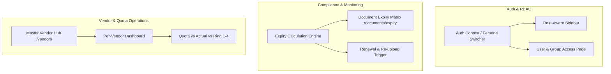

# WFM System Enhancements Implementation Plan (Phase 1 & Phase 2)

> **For agentic workers:** REQUIRED SUB-SKILL: Use superpowers:subagent-driven-development to implement this plan task-by-task. Steps use checkbox (`- [ ]`) syntax for tracking.

**Goal:** Implement the priority WFM enhancements: User & Group Access System with live role switching, Document Due Date & Expiry Monitoring, Vendor Master management, and Per-Vendor Quota & Ring 1–4 Analytics.

**Architecture:** Extend Next.js App Router with client context for RBAC & Persona switching, create server-driven views and REST endpoints for document expiry calculation and vendor quota tracking, and provide intuitive UI tables with filtering and status badges.

**Architecture Diagram:**

**Tech Stack:** Next.js 14 (App Router), TypeScript, Prisma ORM, SQLite, Tailwind CSS, Lucide React icons.

**Spec:** [docs/superpowers/specs/2026-09-21-mms-manpower-mobility-system-design.md](file:///e:/Project/Man%20Power/docs/superpowers/specs/2026-09-21-mms-manpower-mobility-system-design.md)

## Global Constraints
- Do not break existing pre-mobilization, mobilization, and approval workflows.
- Use existing Tailwind CSS color tokens and design system consistency.
- All date calculations must handle null expiry dates gracefully.

---

### Task 1: User & Group Access System (RBAC, Topbar Role Switcher & User Management)

**Files:**
- Modify: `src/lib/auth.ts`
- Create: `src/components/layout/RoleSwitcher.tsx`
- Modify: `src/components/layout/Topbar.tsx`
- Create: `src/app/(dashboard)/users/page.tsx`
- Create: `src/app/(dashboard)/users/UserManagementClient.tsx`
- Create: `src/app/api/v1/users/route.ts`

**Interfaces:**
- Consumes: Prisma `User`, `Company`
- Produces: Live persona switching state in client context, User directory & role assignment page

- [ ] **Step 1: Enhance `src/lib/auth.ts` with role capabilities and client helper**
- [ ] **Step 2: Create `RoleSwitcher.tsx` component with instant persona switcher modal/dropdown**
- [ ] **Step 3: Integrate `RoleSwitcher` and user profile badge into `Topbar.tsx`**
- [ ] **Step 4: Create API endpoint `src/app/api/v1/users/route.ts` for listing and updating user roles**
- [ ] **Step 5: Create User Management view at `src/app/(dashboard)/users/page.tsx` and `UserManagementClient.tsx`**
- [ ] **Step 6: Verify User Management table and role switching in browser**

---

### Task 2: Document Due Date & Expiry Monitoring Matrix

**Files:**
- Create: `src/app/(dashboard)/documents/expiry/page.tsx`
- Create: `src/app/(dashboard)/documents/expiry/ExpiryWatchlistClient.tsx`
- Create: `src/app/api/v1/documents/expiry/route.ts`
- Modify: `src/components/layout/Sidebar.tsx` (add sub-link / badge for expiry monitoring)

**Interfaces:**
- Consumes: `WorkerDocument`, `Worker`, `DocumentType`, `WorkerAssignment`
- Produces: Expiry threshold buckets (Expired, <30 Hari, <60 Hari, >60 Hari), category filters (PKWT, MCU, K3, SIO)

- [ ] **Step 1: Create API endpoint `src/app/api/v1/documents/expiry/route.ts` calculating days remaining and status buckets**
- [ ] **Step 2: Create `ExpiryWatchlistClient.tsx` with filter tabs (All, Expired, Urgent <30d, Warning <60d, Safe), search, and document type filters**
- [ ] **Step 3: Create Server Component page `src/app/(dashboard)/documents/expiry/page.tsx`**
- [ ] **Step 4: Update `Sidebar.tsx` to include "Document Expiry Watchlist" navigation**
- [ ] **Step 5: Test document expiry calculations and interactive filters**

---

### Task 3: Master Vendor Management & Per-Vendor Dashboard (Quota & Ring 1–4)

**Files:**
- Create: `src/app/(dashboard)/vendors/page.tsx`
- Create: `src/app/(dashboard)/vendors/VendorManagementClient.tsx`
- Create: `src/app/(dashboard)/vendors/[id]/page.tsx`
- Create: `src/app/(dashboard)/vendors/[id]/VendorDashboardClient.tsx`
- Create: `src/app/api/v1/vendors/route.ts`
- Modify: `src/components/layout/Sidebar.tsx` (add Master Vendor menu)

**Interfaces:**
- Consumes: `Company`, `WorkerAssignment`, `Worker`, `Site`, `Project`
- Produces: Vendor directory, Vendor contact PICs, Quota vs Actual breakdown, Ring 1-4 demographic chart

- [ ] **Step 1: Create API endpoint `src/app/api/v1/vendors/route.ts` returning vendors with headcount stats and Ring distribution**
- [ ] **Step 2: Create Master Vendor listing page at `src/app/(dashboard)/vendors/page.tsx` & `VendorManagementClient.tsx`**
- [ ] **Step 3: Create Per-Vendor Analytics Portal at `src/app/(dashboard)/vendors/[id]/page.tsx` & `VendorDashboardClient.tsx` showing Quota vs Actual and Ring 1-4 breakdown**
- [ ] **Step 4: Add Vendor Management to `Sidebar.tsx`**
- [ ] **Step 5: Verify Vendor Dashboard and analytics calculations**

---

### Task 4: In-App Due Date Notification Bell & System Verification

**Files:**
- Create: `src/components/layout/NotificationDropdown.tsx`
- Modify: `src/components/layout/Topbar.tsx`
- Modify: `src/app/(dashboard)/page.tsx` (add direct link to Expiry Watchlist and Vendor Quotas)

- [ ] **Step 1: Build `NotificationDropdown.tsx` with dynamic alerts for expiring documents & pending approvals**
- [ ] **Step 2: Mount `NotificationDropdown` into `Topbar.tsx` with live unread badge count**
- [ ] **Step 3: Link Expiry & Vendor cards directly into the main Executive Dashboard**
- [ ] **Step 4: End-to-end sanity check across all updated routes**
