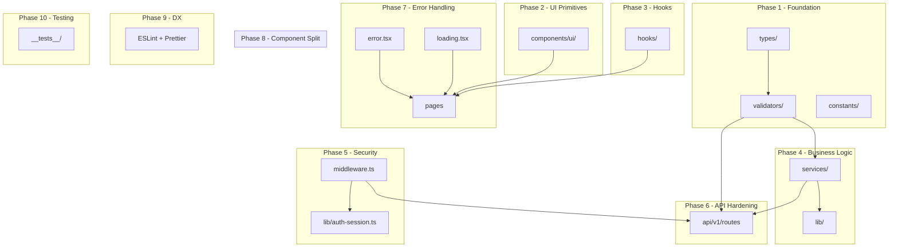

# MMS Project Refactoring — Implementation Plan

> **For agentic workers:** REQUIRED SUB-SKILL: Use superpowers:subagent-driven-development to implement this plan task-by-task. Steps use checkbox (`- [ ]`) syntax for tracking.

**Goal:** Refactor the MMS (Manpower Mobility System) from a functional MVP (score 5.0/10) to a production-ready application (target 8.5+/10) by systematically addressing security, architecture, type safety, component design, error handling, and code quality issues.

**Architecture:**
The refactoring follows a bottom-up approach: first establishing the type foundation and shared UI primitives, then extracting business logic into a service layer, adding auth middleware, hardening APIs, implementing error boundaries, decomposing god components, and finally adding testing infrastructure. Each phase builds on the previous one — types feed validators, validators feed services, services feed routes.

**Architecture Diagram:**



**Tech Stack:** Next.js 14 App Router, TypeScript 5.6, Prisma 5, Tailwind CSS 3, Zod, bcryptjs, jose (JWT)

**Spec:** [Project Structure Analysis](file:///C:/Users/USER/.gemini/antigravity-ide/brain/e01abeb0-4931-4303-b128-2a0756611aa4/project_structure_analysis.md)

## Global Constraints

- Node.js >= 18, Next.js 14.2.x (DO NOT upgrade to 15)
- All new files must use TypeScript strict mode (no `any`)
- Prisma schema changes must include migration commands
- Every `page.tsx` is a Server Component; client logic goes to `*Client.tsx`
- API responses must follow `{ success: boolean, data?: T, error?: string, meta?: { page, limit, total } }` envelope
- All constants (roles, statuses, disciplines) must come from `src/constants/`, never hardcoded strings
- Commit after each task completion with conventional commit messages

---

## Phase 1: Type System Foundation

### Task 1: Domain Constants & Enums

**Files:**
- Create: `src/constants/roles.ts`
- Create: `src/constants/statuses.ts`
- Create: `src/constants/disciplines.ts`
- Create: `src/constants/index.ts`

**Interfaces:**
- Consumes: nothing (foundational)
- Produces: `MMSUserRole`, `WorkerStatus`, `AssignmentStatus`, `PreMobStatus`, `MobilizationStatus`, `DemobilizationStatus`, `DocumentCategory`, `Discipline`, `SiteType`, `CompanyType` — all as `const` objects + TypeScript union types

- [ ] **Step 1: Create `src/constants/roles.ts`**

```typescript
export const USER_ROLES = {
  SYSTEM_ADMIN: "SYSTEM_ADMIN",
  WFM_OFFICER: "WFM_OFFICER",
  SUBCONTRACTOR: "SUBCONTRACTOR",
  CONTRACTOR_HR: "CONTRACTOR_HR",
  CONTRACTOR_HSE: "CONTRACTOR_HSE",
  CLIENT_APPROVER: "CLIENT_APPROVER",
  SITE_ADMIN: "SITE_ADMIN",
  MANAGEMENT_VIEWER: "MANAGEMENT_VIEWER",
} as const;

export type UserRole = (typeof USER_ROLES)[keyof typeof USER_ROLES];

export const ROLE_LABELS: Record<UserRole, string> = {
  SYSTEM_ADMIN: "System Administrator",
  WFM_OFFICER: "Workforce Mobility Officer",
  SUBCONTRACTOR: "Vendor / Subcontractor Admin",
  CONTRACTOR_HR: "Main Contractor HR",
  CONTRACTOR_HSE: "Main Contractor HSE & Medical",
  CLIENT_APPROVER: "Client Project Representative",
  SITE_ADMIN: "Site Administrator",
  MANAGEMENT_VIEWER: "Management Viewer",
};
```

- [ ] **Step 2: Create `src/constants/statuses.ts`**

```typescript
export const WORKER_STATUS = {
  ACTIVE: "ACTIVE",
  INACTIVE: "INACTIVE",
  BLACKLISTED: "BLACKLISTED",
} as const;
export type WorkerStatus = (typeof WORKER_STATUS)[keyof typeof WORKER_STATUS];

export const ASSIGNMENT_STATUS = {
  PLANNED: "PLANNED",
  PRE_MOBILIZATION: "PRE_MOBILIZATION",
  READY_TO_MOBILIZE: "READY_TO_MOBILIZE",
  MOBILIZED: "MOBILIZED",
  ON_SITE: "ON_SITE",
  DEMOBILIZING: "DEMOBILIZING",
  DEMOBILIZED: "DEMOBILIZED",
  CANCELLED: "CANCELLED",
} as const;
export type AssignmentStatus = (typeof ASSIGNMENT_STATUS)[keyof typeof ASSIGNMENT_STATUS];

export const PREMOB_STATUS = {
  DRAFT: "DRAFT",
  SUBMITTED: "SUBMITTED",
  IN_REVIEW: "IN_REVIEW",
  APPROVED: "APPROVED",
  REVISION_REQUIRED: "REVISION_REQUIRED",
  REJECTED: "REJECTED",
  BLOCKED: "BLOCKED",
} as const;
export type PreMobStatus = (typeof PREMOB_STATUS)[keyof typeof PREMOB_STATUS];

export const MOBILIZATION_STATUS = {
  SCHEDULED: "SCHEDULED",
  IN_TRANSIT: "IN_TRANSIT",
  ARRIVED: "ARRIVED",
  CANCELLED: "CANCELLED",
} as const;
export type MobilizationStatus = (typeof MOBILIZATION_STATUS)[keyof typeof MOBILIZATION_STATUS];

export const DEMOBILIZATION_STATUS = {
  REQUESTED: "REQUESTED",
  IN_CLEARANCE: "IN_CLEARANCE",
  CLEARED: "CLEARED",
  CLOSED: "CLOSED",
  CANCELLED: "CANCELLED",
} as const;
export type DemobStatus = (typeof DEMOBILIZATION_STATUS)[keyof typeof DEMOBILIZATION_STATUS];

export const VERIFICATION_STATUS = {
  PENDING: "PENDING",
  VERIFIED: "VERIFIED",
  REJECTED: "REJECTED",
  EXPIRED: "EXPIRED",
} as const;
export type VerificationStatus = (typeof VERIFICATION_STATUS)[keyof typeof VERIFICATION_STATUS];

export const DOCUMENT_CATEGORY = {
  IDENTITY: "IDENTITY",
  MEDICAL: "MEDICAL",
  HSE: "HSE",
  COMPETENCY: "COMPETENCY",
  LEGAL: "LEGAL",
  INSURANCE: "INSURANCE",
} as const;
export type DocumentCategory = (typeof DOCUMENT_CATEGORY)[keyof typeof DOCUMENT_CATEGORY];
```

- [ ] **Step 3: Create `src/constants/disciplines.ts`**

```typescript
export const DISCIPLINES = {
  CIVIL: "CIVIL",
  MECHANICAL: "MECHANICAL",
  ELECTRICAL: "ELECTRICAL",
  INSTRUMENTATION: "INSTRUMENTATION",
  PIPING: "PIPING",
  HSE: "HSE",
  DRILLING: "DRILLING",
  LOGISTICS: "LOGISTICS",
  ADMIN: "ADMIN",
} as const;
export type Discipline = (typeof DISCIPLINES)[keyof typeof DISCIPLINES];

export const SITE_TYPES = {
  ONSHORE: "ONSHORE",
  OFFSHORE: "OFFSHORE",
  REMOTE: "REMOTE",
  FABRICATION_YARD: "FABRICATION_YARD",
} as const;
export type SiteType = (typeof SITE_TYPES)[keyof typeof SITE_TYPES];

export const COMPANY_TYPES = {
  CLIENT: "CLIENT",
  MAIN_CONTRACTOR: "MAIN_CONTRACTOR",
  SUBCONTRACTOR: "SUBCONTRACTOR",
  VENDOR: "VENDOR",
} as const;
export type CompanyType = (typeof COMPANY_TYPES)[keyof typeof COMPANY_TYPES];

export const GENDER = { MALE: "MALE", FEMALE: "FEMALE" } as const;
export type Gender = (typeof GENDER)[keyof typeof GENDER];

export const TRAVEL_METHODS = {
  FLIGHT: "FLIGHT",
  SPEEDBOAT: "SPEEDBOAT",
  BUS: "BUS",
  CHARTER: "CHARTER",
} as const;
export type TravelMethod = (typeof TRAVEL_METHODS)[keyof typeof TRAVEL_METHODS];

export const DEMOB_REASONS = {
  CONTRACT_END: "CONTRACT_END",
  ROTATION_LEAVE: "ROTATION_LEAVE",
  MEDICAL_EVACUATION: "MEDICAL_EVACUATION",
  RESIGNATION: "RESIGNATION",
  DISMISSAL: "DISMISSAL",
} as const;
export type DemobReason = (typeof DEMOB_REASONS)[keyof typeof DEMOB_REASONS];
```

- [ ] **Step 4: Create barrel export `src/constants/index.ts`**

```typescript
export * from "./roles";
export * from "./statuses";
export * from "./disciplines";
```

- [ ] **Step 5: Commit**

```bash
git add src/constants/
git commit -m "feat: add domain constants and enum types for all entities"
```

---

### Task 2: TypeScript Domain Interfaces

**Files:**
- Create: `src/types/api.ts`
- Create: `src/types/worker.ts`
- Create: `src/types/mobilization.ts`
- Create: `src/types/document.ts`
- Create: `src/types/company.ts`
- Create: `src/types/index.ts`
- Modify: `src/types/declarations.d.ts` — remove `declare module 'lucide-react'` (unnecessary with @types)

**Interfaces:**
- Consumes: `UserRole`, `WorkerStatus`, `AssignmentStatus`, etc. from `src/constants/`
- Produces: `ApiResponse<T>`, `PaginatedResponse<T>`, `WorkerListItem`, `WorkerDetail`, `AssignmentSummary`, `MobilizationRecord`, `DemobilizationRecord`, `DocumentSummary`, `CompanySummary`

- [ ] **Step 1: Create `src/types/api.ts`**

```typescript
export interface ApiResponse<T = unknown> {
  success: boolean;
  data?: T;
  error?: string;
  message?: string;
  meta?: PaginationMeta;
}

export interface PaginationMeta {
  page: number;
  limit: number;
  total: number;
  totalPages: number;
}

export interface PaginationParams {
  page?: number;
  limit?: number;
}

export interface SearchParams extends PaginationParams {
  q?: string;
}
```

- [ ] **Step 2: Create `src/types/worker.ts`**

```typescript
import type { WorkerStatus, AssignmentStatus, Gender, Discipline } from "@/constants";

export interface WorkerListItem {
  id: string;
  fullName: string;
  nik: string;
  employeeNo: string;
  birthDate: string;
  gender: Gender;
  status: WorkerStatus;
  overallReadinessScore: number;
  assignments: AssignmentSummary[];
}

export interface AssignmentSummary {
  id: string;
  position: string;
  discipline: Discipline;
  status: AssignmentStatus;
  rotationSchedule: string | null;
  company: { name: string; type: string } | null;
  project: { name: string; code: string } | null;
  site: { name: string; code: string } | null;
}

export interface WorkerCreateInput {
  fullName: string;
  nik: string;
  employeeNo?: string;
  passportNo?: string;
  birthDate: string;
  birthPlace?: string;
  gender: Gender;
  nationality?: string;
  contactNumber: string;
  email?: string;
  address?: string;
  companyId?: string;
  projectId?: string;
  siteId?: string;
  position?: string;
  discipline?: Discipline;
  trade?: string;
  rotationSchedule?: string;
  startDate?: string;
}
```

- [ ] **Step 3: Create `src/types/mobilization.ts`**

```typescript
import type { MobilizationStatus, DemobStatus, PreMobStatus, TravelMethod, DemobReason } from "@/constants";

export interface PreMobilizationRecord {
  id: string;
  requestNo: string;
  assignmentId: string;
  plannedDate: string;
  readinessScore: number;
  blockingCount: number;
  status: PreMobStatus;
  currentStep: string;
  submittedAt: string | null;
}

export interface MobilizationRecord {
  id: string;
  preMobilizationId: string;
  assignmentId: string;
  travelMethod: TravelMethod;
  flightOrVehicleNo: string;
  departurePoint: string;
  departureDate: string;
  estimatedArrivalDate: string;
  actualArrivalDate: string | null;
  status: MobilizationStatus;
}

export interface DemobilizationRecord {
  id: string;
  assignmentId: string;
  reason: DemobReason;
  requestDate: string;
  plannedDepartureDate: string;
  actualDepartureDate: string | null;
  status: DemobStatus;
  clearanceItems: ClearanceItemRecord[];
}

export interface ClearanceItemRecord {
  id: string;
  itemName: string;
  category: string;
  isCleared: boolean;
  clearedBy: string | null;
  clearedAt: string | null;
  remarks: string | null;
}
```

- [ ] **Step 4: Create `src/types/document.ts`**

```typescript
import type { VerificationStatus, DocumentCategory } from "@/constants";

export interface DocumentSummary {
  id: string;
  documentTypeId: string;
  documentType: { code: string; name: string; category: DocumentCategory };
  documentNumber: string;
  issueDate: string;
  expiryDate: string | null;
  verificationStatus: VerificationStatus;
}

export interface DocumentTypeInfo {
  id: string;
  code: string;
  name: string;
  category: DocumentCategory;
  defaultValidityDays: number | null;
}
```

- [ ] **Step 5: Create `src/types/company.ts`**

```typescript
import type { CompanyType } from "@/constants";

export interface CompanySummary {
  id: string;
  name: string;
  code: string;
  type: CompanyType;
}

export interface ProjectSummary {
  id: string;
  name: string;
  code: string;
}

export interface SiteSummary {
  id: string;
  name: string;
  code: string;
  siteType: string;
}

export interface OptionItem {
  id: string;
  name: string;
  code?: string;
  type?: string;
  projectId?: string;
}
```

- [ ] **Step 6: Create barrel export `src/types/index.ts`**

```typescript
export * from "./api";
export * from "./worker";
export * from "./mobilization";
export * from "./document";
export * from "./company";
```

- [ ] **Step 7: Clean up `src/types/declarations.d.ts`**

Remove the unnecessary `declare module 'lucide-react';` line — the package ships its own types.

- [ ] **Step 8: Commit**

```bash
git add src/types/
git commit -m "feat: add comprehensive TypeScript interfaces for all domain entities"
```

---

### Task 3: Zod Validation Schemas

**Files:**
- Install: `zod`
- Create: `src/validators/worker.schema.ts`
- Create: `src/validators/mobilization.schema.ts`
- Create: `src/validators/demobilization.schema.ts`
- Create: `src/validators/common.schema.ts`
- Create: `src/validators/index.ts`

**Interfaces:**
- Consumes: constants from `src/constants/`
- Produces: `createWorkerSchema`, `createPreMobSchema`, `createDemobSchema`, `paginationSchema`, `idParamSchema` — Zod schemas with `.parse()` and inferred types

- [ ] **Step 1: Install Zod**

```bash
npm install zod
```

- [ ] **Step 2: Create `src/validators/common.schema.ts`**

```typescript
import { z } from "zod";

export const paginationSchema = z.object({
  page: z.coerce.number().int().min(1).default(1),
  limit: z.coerce.number().int().min(1).max(100).default(20),
});

export const idParamSchema = z.object({
  id: z.string().uuid("Invalid ID format"),
});

export const searchSchema = paginationSchema.extend({
  q: z.string().optional().default(""),
});

export type PaginationInput = z.infer<typeof paginationSchema>;
export type SearchInput = z.infer<typeof searchSchema>;
```

- [ ] **Step 3: Create `src/validators/worker.schema.ts`**

```typescript
import { z } from "zod";
import { WORKER_STATUS, GENDER, DISCIPLINES } from "@/constants";

export const createWorkerSchema = z.object({
  fullName: z.string().min(2, "Full name must be at least 2 characters").max(255),
  nik: z.string().regex(/^\d{16}$/, "NIK must be exactly 16 digits"),
  employeeNo: z.string().optional(),
  passportNo: z.string().optional(),
  birthDate: z.string().refine((d) => !isNaN(Date.parse(d)), "Invalid date format"),
  birthPlace: z.string().optional(),
  gender: z.enum([GENDER.MALE, GENDER.FEMALE]),
  nationality: z.string().default("INDONESIAN"),
  contactNumber: z.string().min(8, "Contact number must be at least 8 characters").max(20),
  email: z.string().email("Invalid email").optional().or(z.literal("")),
  address: z.string().optional(),
  // Optional assignment fields
  companyId: z.string().uuid().optional(),
  projectId: z.string().uuid().optional(),
  siteId: z.string().uuid().optional(),
  position: z.string().optional(),
  discipline: z.enum(Object.values(DISCIPLINES) as [string, ...string[]]).optional(),
  trade: z.string().optional(),
  rotationSchedule: z.string().optional(),
  startDate: z.string().optional(),
});

export type CreateWorkerInput = z.infer<typeof createWorkerSchema>;

export const workerSearchSchema = z.object({
  q: z.string().optional().default(""),
  status: z.enum(Object.values(WORKER_STATUS) as [string, ...string[]]).optional(),
  companyId: z.string().uuid().optional(),
  page: z.coerce.number().int().min(1).default(1),
  limit: z.coerce.number().int().min(1).max(100).default(20),
});
```

- [ ] **Step 4: Create `src/validators/mobilization.schema.ts`**

```typescript
import { z } from "zod";
import { TRAVEL_METHODS } from "@/constants";

export const createPreMobSchema = z.object({
  assignmentId: z.string().uuid("Assignment ID must be a valid UUID"),
});

export type CreatePreMobInput = z.infer<typeof createPreMobSchema>;

export const createMobilizationSchema = z.object({
  preMobilizationId: z.string().uuid(),
  assignmentId: z.string().uuid(),
  travelMethod: z.enum(Object.values(TRAVEL_METHODS) as [string, ...string[]]),
  flightOrVehicleNo: z.string().min(1, "Flight/vehicle number is required"),
  departurePoint: z.string().min(1, "Departure point is required"),
  departureDate: z.string().refine((d) => !isNaN(Date.parse(d)), "Invalid date"),
  estimatedArrivalDate: z.string().refine((d) => !isNaN(Date.parse(d)), "Invalid date"),
});

export const arrivalConfirmSchema = z.object({
  confirmedBy: z.string().min(1, "Confirmed by is required"),
});
```

- [ ] **Step 5: Create `src/validators/demobilization.schema.ts`**

```typescript
import { z } from "zod";
import { DEMOB_REASONS } from "@/constants";

export const createDemobSchema = z.object({
  assignmentId: z.string().uuid("Assignment ID must be a valid UUID"),
  reason: z.enum(Object.values(DEMOB_REASONS) as [string, ...string[]]),
  plannedDepartureDate: z.string().refine((d) => !isNaN(Date.parse(d)), "Invalid date"),
});

export type CreateDemobInput = z.infer<typeof createDemobSchema>;

export const clearanceUpdateSchema = z.object({
  isCleared: z.boolean(),
  clearedBy: z.string().optional(),
  remarks: z.string().optional(),
});
```

- [ ] **Step 6: Create barrel export `src/validators/index.ts`**

```typescript
export * from "./common.schema";
export * from "./worker.schema";
export * from "./mobilization.schema";
export * from "./demobilization.schema";
```

- [ ] **Step 7: Commit**

```bash
git add package.json package-lock.json src/validators/
git commit -m "feat: add Zod validation schemas for all API inputs"
```

---

## Phase 2: Reusable UI Component Library

### Task 4: Core UI Components

**Files:**
- Create: `src/components/ui/Button.tsx`
- Create: `src/components/ui/Input.tsx`
- Create: `src/components/ui/Select.tsx`
- Create: `src/components/ui/Modal.tsx`
- Create: `src/components/ui/Card.tsx`
- Create: `src/components/ui/Badge.tsx`
- Create: `src/components/ui/LoadingSpinner.tsx`
- Create: `src/components/ui/EmptyState.tsx`
- Create: `src/components/ui/Pagination.tsx`
- Create: `src/components/ui/SearchInput.tsx`
- Create: `src/components/ui/ConfirmDialog.tsx`
- Create: `src/components/ui/index.ts`

**Interfaces:**
- Consumes: nothing (foundational UI)
- Produces: All UI primitives used by every page component

> **IMPORTANT:** All components must use `clsx` + `tailwind-merge` (already installed as `clsx` and `tailwind-merge`) for className merging. Each component must accept a `className` prop for external override.

- [ ] **Step 1: Create `src/components/ui/Button.tsx`**

```tsx
import React from "react";
import { clsx } from "clsx";
import { twMerge } from "tailwind-merge";

const variants = {
  primary: "bg-brand-600 hover:bg-brand-500 text-white shadow-sm",
  secondary: "bg-white hover:bg-slate-50 text-slate-700 border border-slate-200 shadow-sm",
  danger: "bg-rose-600 hover:bg-rose-500 text-white shadow-sm",
  ghost: "hover:bg-slate-100 text-slate-600",
} as const;

const sizes = {
  sm: "px-3 py-1.5 text-xs",
  md: "px-4 py-2 text-xs",
  lg: "px-5 py-2.5 text-sm",
} as const;

interface ButtonProps extends React.ButtonHTMLAttributes<HTMLButtonElement> {
  variant?: keyof typeof variants;
  size?: keyof typeof sizes;
  icon?: React.ReactNode;
  loading?: boolean;
}

export function Button({
  variant = "primary",
  size = "md",
  icon,
  loading,
  className,
  children,
  disabled,
  ...props
}: ButtonProps) {
  return (
    <button
      className={twMerge(
        clsx(
          "inline-flex items-center justify-center gap-2 rounded-lg font-medium transition-colors focus:outline-none focus:ring-2 focus:ring-brand-500/20 disabled:opacity-50 disabled:cursor-not-allowed",
          variants[variant],
          sizes[size],
          className
        )
      )}
      disabled={disabled || loading}
      {...props}
    >
      {loading ? <LoadingDots /> : icon}
      {children}
    </button>
  );
}

function LoadingDots() {
  return (
    <span className="flex gap-1">
      <span className="w-1 h-1 rounded-full bg-current animate-bounce [animation-delay:-0.3s]" />
      <span className="w-1 h-1 rounded-full bg-current animate-bounce [animation-delay:-0.15s]" />
      <span className="w-1 h-1 rounded-full bg-current animate-bounce" />
    </span>
  );
}
```

- [ ] **Step 2: Create `src/components/ui/Input.tsx`**

```tsx
import React from "react";
import { twMerge } from "tailwind-merge";
import { clsx } from "clsx";

interface InputProps extends React.InputHTMLAttributes<HTMLInputElement> {
  label?: string;
  error?: string;
  hint?: string;
}

export const Input = React.forwardRef<HTMLInputElement, InputProps>(
  ({ label, error, hint, className, id, ...props }, ref) => {
    const inputId = id || label?.toLowerCase().replace(/\s+/g, "-");
    return (
      <div className="space-y-1">
        {label && (
          <label htmlFor={inputId} className="block text-xs font-medium text-slate-700">
            {label}
            {props.required && <span className="text-rose-500 ml-0.5">*</span>}
          </label>
        )}
        <input
          ref={ref}
          id={inputId}
          className={twMerge(
            clsx(
              "w-full px-3 py-2 text-xs bg-slate-50 border rounded-lg transition",
              "focus:outline-none focus:ring-2 focus:ring-brand-500/20 focus:border-brand-500",
              "text-slate-800 placeholder:text-slate-400",
              error ? "border-rose-400 focus:ring-rose-500/20 focus:border-rose-500" : "border-slate-200",
              className
            )
          )}
          {...props}
        />
        {error && <p className="text-[11px] text-rose-600">{error}</p>}
        {hint && !error && <p className="text-[11px] text-slate-400">{hint}</p>}
      </div>
    );
  }
);
Input.displayName = "Input";
```

- [ ] **Step 3: Create `src/components/ui/Select.tsx`**

```tsx
import React from "react";
import { twMerge } from "tailwind-merge";
import { clsx } from "clsx";

interface SelectOption {
  value: string;
  label: string;
}

interface SelectProps extends React.SelectHTMLAttributes<HTMLSelectElement> {
  label?: string;
  error?: string;
  options: SelectOption[];
  placeholder?: string;
}

export const Select = React.forwardRef<HTMLSelectElement, SelectProps>(
  ({ label, error, options, placeholder, className, id, ...props }, ref) => {
    const selectId = id || label?.toLowerCase().replace(/\s+/g, "-");
    return (
      <div className="space-y-1">
        {label && (
          <label htmlFor={selectId} className="block text-xs font-medium text-slate-700">
            {label}
            {props.required && <span className="text-rose-500 ml-0.5">*</span>}
          </label>
        )}
        <select
          ref={ref}
          id={selectId}
          className={twMerge(
            clsx(
              "w-full px-3 py-2 text-xs bg-slate-50 border rounded-lg transition",
              "focus:outline-none focus:ring-2 focus:ring-brand-500/20 focus:border-brand-500 text-slate-700",
              error ? "border-rose-400" : "border-slate-200",
              className
            )
          )}
          {...props}
        >
          {placeholder && <option value="">{placeholder}</option>}
          {options.map((opt) => (
            <option key={opt.value} value={opt.value}>{opt.label}</option>
          ))}
        </select>
        {error && <p className="text-[11px] text-rose-600">{error}</p>}
      </div>
    );
  }
);
Select.displayName = "Select";
```

- [ ] **Step 4: Create `src/components/ui/Modal.tsx`**

```tsx
"use client";
import React, { useEffect, useRef } from "react";
import { X } from "lucide-react";

interface ModalProps {
  isOpen: boolean;
  onClose: () => void;
  title: string;
  description?: string;
  children: React.ReactNode;
  size?: "sm" | "md" | "lg" | "xl";
}

const sizeClasses = {
  sm: "max-w-md",
  md: "max-w-lg",
  lg: "max-w-2xl",
  xl: "max-w-4xl",
};

export function Modal({ isOpen, onClose, title, description, children, size = "md" }: ModalProps) {
  const overlayRef = useRef<HTMLDivElement>(null);

  useEffect(() => {
    if (isOpen) {
      document.body.style.overflow = "hidden";
    }
    return () => {
      document.body.style.overflow = "";
    };
  }, [isOpen]);

  useEffect(() => {
    const handleEscape = (e: KeyboardEvent) => {
      if (e.key === "Escape") onClose();
    };
    if (isOpen) document.addEventListener("keydown", handleEscape);
    return () => document.removeEventListener("keydown", handleEscape);
  }, [isOpen, onClose]);

  if (!isOpen) return null;

  return (
    <div
      ref={overlayRef}
      className="fixed inset-0 z-50 flex items-center justify-center p-4 bg-black/50 backdrop-blur-sm"
      onClick={(e) => e.target === overlayRef.current && onClose()}
    >
      <div className={`bg-white rounded-xl shadow-xl w-full ${sizeClasses[size]} max-h-[90vh] flex flex-col`}>
        <div className="flex items-center justify-between p-5 border-b border-slate-200">
          <div>
            <h2 className="text-base font-bold text-slate-900">{title}</h2>
            {description && <p className="text-xs text-slate-500 mt-0.5">{description}</p>}
          </div>
          <button onClick={onClose} className="p-1 rounded-md hover:bg-slate-100 text-slate-400 hover:text-slate-600 transition">
            <X className="w-4 h-4" />
          </button>
        </div>
        <div className="flex-1 overflow-y-auto p-5">{children}</div>
      </div>
    </div>
  );
}
```

- [ ] **Step 5: Create `src/components/ui/Card.tsx`**

```tsx
import React from "react";
import { twMerge } from "tailwind-merge";

interface CardProps {
  children: React.ReactNode;
  className?: string;
  padding?: "none" | "sm" | "md" | "lg";
}

const paddingClasses = {
  none: "",
  sm: "p-3",
  md: "p-4",
  lg: "p-6",
};

export function Card({ children, className, padding = "md" }: CardProps) {
  return (
    <div className={twMerge("bg-white rounded-xl border border-slate-200/80 shadow-sm", paddingClasses[padding], className)}>
      {children}
    </div>
  );
}
```

- [ ] **Step 6: Create `src/components/ui/Badge.tsx`**

```tsx
import React from "react";
import { twMerge } from "tailwind-merge";

const colorMap: Record<string, string> = {
  green: "bg-emerald-100 text-emerald-800",
  red: "bg-rose-100 text-rose-800",
  yellow: "bg-amber-100 text-amber-800",
  blue: "bg-blue-100 text-blue-800",
  purple: "bg-purple-100 text-purple-800",
  gray: "bg-slate-100 text-slate-700",
  orange: "bg-orange-100 text-orange-800",
};

interface BadgeProps {
  children: React.ReactNode;
  color?: keyof typeof colorMap;
  className?: string;
}

export function Badge({ children, color = "gray", className }: BadgeProps) {
  return (
    <span className={twMerge("inline-flex items-center px-2 py-0.5 rounded-full text-[11px] font-bold", colorMap[color], className)}>
      {children}
    </span>
  );
}
```

- [ ] **Step 7: Create `src/components/ui/LoadingSpinner.tsx`**

```tsx
import React from "react";

interface LoadingSpinnerProps {
  size?: "sm" | "md" | "lg";
  message?: string;
}

const sizeClasses = { sm: "w-4 h-4", md: "w-6 h-6", lg: "w-8 h-8" };

export function LoadingSpinner({ size = "md", message }: LoadingSpinnerProps) {
  return (
    <div className="flex flex-col items-center justify-center gap-3 py-12">
      <div className={`${sizeClasses[size]} border-2 border-slate-200 border-t-brand-600 rounded-full animate-spin`} />
      {message && <p className="text-xs text-slate-500">{message}</p>}
    </div>
  );
}
```

- [ ] **Step 8: Create `src/components/ui/EmptyState.tsx`**

```tsx
import React from "react";

interface EmptyStateProps {
  icon?: React.ReactNode;
  title: string;
  description?: string;
  action?: React.ReactNode;
}

export function EmptyState({ icon, title, description, action }: EmptyStateProps) {
  return (
    <div className="flex flex-col items-center justify-center py-12 text-center">
      {icon && <div className="text-slate-300 mb-3">{icon}</div>}
      <h3 className="text-sm font-semibold text-slate-700">{title}</h3>
      {description && <p className="text-xs text-slate-400 mt-1 max-w-sm">{description}</p>}
      {action && <div className="mt-4">{action}</div>}
    </div>
  );
}
```

- [ ] **Step 9: Create `src/components/ui/Pagination.tsx`**

```tsx
"use client";
import React from "react";
import { ChevronLeft, ChevronRight } from "lucide-react";
import { Button } from "./Button";

interface PaginationProps {
  page: number;
  totalPages: number;
  onPageChange: (page: number) => void;
}

export function Pagination({ page, totalPages, onPageChange }: PaginationProps) {
  if (totalPages <= 1) return null;

  return (
    <div className="flex items-center justify-between px-4 py-3 border-t border-slate-200">
      <p className="text-xs text-slate-500">
        Page {page} of {totalPages}
      </p>
      <div className="flex gap-1">
        <Button variant="secondary" size="sm" disabled={page <= 1} onClick={() => onPageChange(page - 1)} icon={<ChevronLeft className="w-3 h-3" />}>
          Prev
        </Button>
        <Button variant="secondary" size="sm" disabled={page >= totalPages} onClick={() => onPageChange(page + 1)} icon={<ChevronRight className="w-3 h-3" />}>
          Next
        </Button>
      </div>
    </div>
  );
}
```

- [ ] **Step 10: Create `src/components/ui/SearchInput.tsx`**

```tsx
"use client";
import React from "react";
import { Search } from "lucide-react";

interface SearchInputProps {
  value: string;
  onChange: (value: string) => void;
  placeholder?: string;
  className?: string;
}

export function SearchInput({ value, onChange, placeholder = "Search...", className }: SearchInputProps) {
  return (
    <div className={`relative flex-1 max-w-md ${className || ""}`}>
      <Search className="w-4 h-4 text-slate-400 absolute left-3 top-1/2 -translate-y-1/2" />
      <input
        type="text"
        placeholder={placeholder}
        value={value}
        onChange={(e) => onChange(e.target.value)}
        className="w-full pl-9 pr-4 py-2 text-xs bg-slate-50 border border-slate-200 rounded-lg focus:outline-none focus:ring-2 focus:ring-brand-500/20 focus:border-brand-500 transition text-slate-800"
      />
    </div>
  );
}
```

- [ ] **Step 11: Create `src/components/ui/ConfirmDialog.tsx`**

```tsx
"use client";
import React from "react";
import { Modal } from "./Modal";
import { Button } from "./Button";
import { AlertTriangle } from "lucide-react";

interface ConfirmDialogProps {
  isOpen: boolean;
  onClose: () => void;
  onConfirm: () => void;
  title: string;
  message: string;
  confirmLabel?: string;
  loading?: boolean;
  variant?: "danger" | "primary";
}

export function ConfirmDialog({
  isOpen, onClose, onConfirm, title, message,
  confirmLabel = "Confirm", loading, variant = "danger",
}: ConfirmDialogProps) {
  return (
    <Modal isOpen={isOpen} onClose={onClose} title={title} size="sm">
      <div className="flex flex-col items-center text-center gap-4">
        <div className={`w-12 h-12 rounded-full flex items-center justify-center ${variant === "danger" ? "bg-rose-100 text-rose-600" : "bg-brand-100 text-brand-600"}`}>
          <AlertTriangle className="w-6 h-6" />
        </div>
        <p className="text-xs text-slate-600">{message}</p>
        <div className="flex gap-2 w-full">
          <Button variant="secondary" className="flex-1" onClick={onClose} disabled={loading}>Cancel</Button>
          <Button variant={variant === "danger" ? "danger" : "primary"} className="flex-1" onClick={onConfirm} loading={loading}>
            {confirmLabel}
          </Button>
        </div>
      </div>
    </Modal>
  );
}
```

- [ ] **Step 12: Create barrel export `src/components/ui/index.ts`**

```typescript
export { Button } from "./Button";
export { Input } from "./Input";
export { Select } from "./Select";
export { Modal } from "./Modal";
export { Card } from "./Card";
export { Badge } from "./Badge";
export { StatusChip } from "./StatusChip";
export { LoadingSpinner } from "./LoadingSpinner";
export { EmptyState } from "./EmptyState";
export { Pagination } from "./Pagination";
export { SearchInput } from "./SearchInput";
export { ConfirmDialog } from "./ConfirmDialog";
```

- [ ] **Step 13: Commit**

```bash
git add src/components/ui/
git commit -m "feat: add reusable UI component library (Button, Input, Modal, Card, etc.)"
```

---

## Phase 3: Custom Hooks

### Task 5: Extract Shared Client Logic into Hooks

**Files:**
- Create: `src/hooks/useDebounce.ts`
- Create: `src/hooks/usePermission.ts`
- Create: `src/hooks/usePagination.ts`
- Create: `src/hooks/useFetch.ts`
- Create: `src/hooks/index.ts`

**Interfaces:**
- Consumes: `MMSUserRole`, `MMSPermission` from `src/lib/auth.ts`, `ApiResponse` from `src/types/`
- Produces: `useDebounce(value, delay)`, `usePermission(role)`, `usePagination(totalPages)`, `useFetch<T>(url)`

- [ ] **Step 1: Create `src/hooks/useDebounce.ts`**

```typescript
"use client";
import { useState, useEffect } from "react";

export function useDebounce<T>(value: T, delay: number = 300): T {
  const [debouncedValue, setDebouncedValue] = useState<T>(value);

  useEffect(() => {
    const timer = setTimeout(() => setDebouncedValue(value), delay);
    return () => clearTimeout(timer);
  }, [value, delay]);

  return debouncedValue;
}
```

- [ ] **Step 2: Create `src/hooks/usePermission.ts`**

```typescript
"use client";
import { useMemo } from "react";
import type { MMSUserRole, MMSPermission } from "@/lib/auth";
import { ROLE_PERMISSIONS } from "@/lib/auth";

export function usePermission(role: MMSUserRole) {
  return useMemo(() => ({
    hasPermission: (permission: MMSPermission) => {
      const permissions = ROLE_PERMISSIONS[role] || [];
      return permissions.includes(permission);
    },
    hasAnyPermission: (...permissions: MMSPermission[]) => {
      const rolePerms = ROLE_PERMISSIONS[role] || [];
      return permissions.some((p) => rolePerms.includes(p));
    },
    permissions: ROLE_PERMISSIONS[role] || [],
  }), [role]);
}
```

- [ ] **Step 3: Create `src/hooks/usePagination.ts`**

```typescript
"use client";
import { useState, useMemo } from "react";

interface UsePaginationOptions {
  initialPage?: number;
  initialLimit?: number;
}

export function usePagination({ initialPage = 1, initialLimit = 20 }: UsePaginationOptions = {}) {
  const [page, setPage] = useState(initialPage);
  const [limit, setLimit] = useState(initialLimit);
  const [total, setTotal] = useState(0);

  const totalPages = useMemo(() => Math.ceil(total / limit) || 1, [total, limit]);

  const goToPage = (newPage: number) => {
    setPage(Math.max(1, Math.min(newPage, totalPages)));
  };

  return {
    page, limit, total, totalPages,
    setPage: goToPage, setLimit, setTotal,
    offset: (page - 1) * limit,
    queryParams: `page=${page}&limit=${limit}`,
  };
}
```

- [ ] **Step 4: Create `src/hooks/useFetch.ts`**

```typescript
"use client";
import { useState, useCallback } from "react";
import type { ApiResponse } from "@/types";

interface FetchState<T> {
  data: T | null;
  loading: boolean;
  error: string | null;
}

export function useFetch<T = unknown>() {
  const [state, setState] = useState<FetchState<T>>({
    data: null,
    loading: false,
    error: null,
  });

  const execute = useCallback(async (url: string, options?: RequestInit): Promise<T | null> => {
    setState((prev) => ({ ...prev, loading: true, error: null }));
    try {
      const res = await fetch(url, options);
      const json: ApiResponse<T> = await res.json();
      if (!json.success) {
        setState({ data: null, loading: false, error: json.error || "Request failed" });
        return null;
      }
      setState({ data: json.data ?? null, loading: false, error: null });
      return json.data ?? null;
    } catch (err) {
      const message = err instanceof Error ? err.message : "Network error";
      setState({ data: null, loading: false, error: message });
      return null;
    }
  }, []);

  const reset = useCallback(() => {
    setState({ data: null, loading: false, error: null });
  }, []);

  return { ...state, execute, reset };
}
```

- [ ] **Step 5: Create barrel export `src/hooks/index.ts`**

```typescript
export { useDebounce } from "./useDebounce";
export { usePermission } from "./usePermission";
export { usePagination } from "./usePagination";
export { useFetch } from "./useFetch";
```

- [ ] **Step 6: Commit**

```bash
git add src/hooks/
git commit -m "feat: add custom hooks (useDebounce, usePermission, usePagination, useFetch)"
```

---

## Phase 4: Service Layer

### Task 6: Worker Service

**Files:**
- Create: `src/services/worker.service.ts`

**Interfaces:**
- Consumes: `prisma` from `src/lib/prisma.ts`, `CreateWorkerInput` from `src/validators/`, `logAuditEvent` from `src/lib/audit.ts`
- Produces: `WorkerService.list(params)`, `WorkerService.create(input, ipAddress)`, `WorkerService.getById(id)`

- [ ] **Step 1: Create `src/services/worker.service.ts`**

```typescript
import { prisma } from "@/lib/prisma";
import { logAuditEvent } from "@/lib/audit";
import type { CreateWorkerInput } from "@/validators/worker.schema";

interface ListWorkersParams {
  q?: string;
  status?: string;
  companyId?: string;
  page: number;
  limit: number;
}

export const WorkerService = {
  async list({ q, status, companyId, page, limit }: ListWorkersParams) {
    const where = {
      AND: [
        q
          ? { OR: [
              { fullName: { contains: q } },
              { nik: { contains: q } },
              { employeeNo: { contains: q } },
            ] }
          : {},
        status ? { status } : {},
        companyId ? { assignments: { some: { companyId } } } : {},
      ],
    };

    const [workers, total] = await Promise.all([
      prisma.worker.findMany({
        where,
        include: {
          assignments: {
            include: { project: true, site: true, company: true },
            orderBy: { createdAt: "desc" },
            take: 1,
          },
          documents: { include: { documentType: true } },
        },
        orderBy: { createdAt: "desc" },
        skip: (page - 1) * limit,
        take: limit,
      }),
      prisma.worker.count({ where }),
    ]);

    return { workers, total, page, limit, totalPages: Math.ceil(total / limit) || 1 };
  },

  async getById(id: string) {
    return prisma.worker.findUnique({
      where: { id },
      include: {
        assignments: {
          include: { project: true, site: true, company: true },
          orderBy: { createdAt: "desc" },
        },
        documents: {
          include: { documentType: true, versions: true },
          orderBy: { createdAt: "desc" },
        },
      },
    });
  },

  async create(input: CreateWorkerInput, ipAddress?: string) {
    // Check duplicate NIK
    const existing = await prisma.worker.findUnique({ where: { nik: input.nik } });
    if (existing) {
      throw new Error(`Worker dengan NIK ${input.nik} sudah terdaftar (${existing.fullName}).`);
    }

    const employeeNo =
      input.employeeNo ||
      `EMP-${new Date().getFullYear()}-${Date.now().toString().slice(-5)}${Math.floor(100 + Math.random() * 900)}`;

    const worker = await prisma.worker.create({
      data: {
        fullName: input.fullName,
        nik: input.nik,
        employeeNo,
        passportNo: input.passportNo || null,
        birthDate: new Date(input.birthDate),
        birthPlace: input.birthPlace || null,
        gender: input.gender,
        nationality: input.nationality || "INDONESIAN",
        contactNumber: input.contactNumber,
        email: input.email || null,
        address: input.address || null,
        status: "ACTIVE",
        overallReadinessScore: 0.0,
      },
    });

    let assignment = null;
    if (input.companyId && input.projectId && input.siteId && input.position) {
      assignment = await prisma.workerAssignment.create({
        data: {
          workerId: worker.id,
          companyId: input.companyId,
          projectId: input.projectId,
          siteId: input.siteId,
          position: input.position,
          discipline: input.discipline || "CIVIL",
          trade: input.trade || null,
          rotationSchedule: input.rotationSchedule || "28/28",
          startDate: input.startDate ? new Date(input.startDate) : new Date(),
          status: "PLANNED",
        },
        include: { company: true, project: true, site: true },
      });
    }

    await logAuditEvent({
      actorName: "HR / WFM Officer",
      action: "CREATE",
      entityType: "WORKER",
      entityId: worker.id,
      payloadAfter: { worker, assignment },
      ipAddress,
    });

    return { ...worker, assignments: assignment ? [assignment] : [] };
  },
};
```

- [ ] **Step 2: Commit**

```bash
git add src/services/worker.service.ts
git commit -m "feat: add WorkerService with list, getById, and create methods"
```

---

### Task 7: Mobilization & Demobilization Services

**Files:**
- Create: `src/services/demobilization.service.ts`
- Create: `src/services/pre-mobilization.service.ts`
- Create: `src/services/index.ts`

**Interfaces:**
- Consumes: `prisma`, `logAuditEvent`, `calculateWorkerReadiness` from `src/lib/`
- Produces: `DemobilizationService.create(input)`, `PreMobilizationService.submit(assignmentId, ipAddress)`

- [ ] **Step 1: Create `src/services/pre-mobilization.service.ts`**

```typescript
import { prisma } from "@/lib/prisma";
import { calculateWorkerReadiness } from "@/lib/readiness-engine";
import { logAuditEvent } from "@/lib/audit";

export const PreMobilizationService = {
  async submit(assignmentId: string, ipAddress?: string) {
    const evaluation = await calculateWorkerReadiness(assignmentId);
    if (evaluation.overallStatus === "BLOCKED") {
      throw new Error("Pekerja memiliki dokumen blocking yang belum terpenuhi. Pengajuan ditolak.");
    }

    const workflow = await prisma.approvalWorkflow.findFirst({
      where: { code: "STD-MOB-V1" },
    });

    const year = new Date().getFullYear();
    const requestNo = `PM-${year}-${Date.now().toString().slice(-4)}${Math.floor(1000 + Math.random() * 9000)}`;

    const preMob = await prisma.preMobilization.create({
      data: {
        requestNo,
        assignmentId,
        plannedDate: new Date(Date.now() + 7 * 24 * 60 * 60 * 1000),
        readinessScore: evaluation.readinessScore,
        blockingCount: evaluation.blockingIssues.length,
        status: "SUBMITTED",
        currentStep: "CONTRACTOR_HR",
        submittedAt: new Date(),
      },
    });

    if (workflow) {
      await prisma.approvalInstance.create({
        data: {
          preMobilizationId: preMob.id,
          workflowId: workflow.id,
          currentStepOrder: 1,
          status: "PENDING",
        },
      });
    }

    await prisma.workerAssignment.update({
      where: { id: assignmentId },
      data: { status: "PRE_MOBILIZATION" },
    });

    await logAuditEvent({
      action: "SUBMIT_PRE_MOBILIZATION",
      entityType: "PRE_MOBILIZATION",
      entityId: preMob.id,
      payloadAfter: { requestNo, assignmentId, score: evaluation.readinessScore },
      ipAddress,
    });

    return { requestNo, preMobId: preMob.id };
  },
};
```

- [ ] **Step 2: Create `src/services/demobilization.service.ts`**

```typescript
import { prisma } from "@/lib/prisma";
import { logAuditEvent } from "@/lib/audit";
import type { CreateDemobInput } from "@/validators/demobilization.schema";

const STANDARD_CLEARANCE_ITEMS = [
  { itemName: "Camp & Accommodation Clearance", category: "LOGISTICS" },
  { itemName: "PPE, Radios & Hand Tool Handover", category: "ASSETS" },
  { itemName: "Site RFID / Security Badge Return", category: "SECURITY" },
  { itemName: "Medical Exit Fitness & Fit-to-Fly Check", category: "HEALTH" },
] as const;

export const DemobilizationService = {
  async create(input: CreateDemobInput) {
    const demob = await prisma.demobilization.create({
      data: {
        assignmentId: input.assignmentId,
        reason: input.reason,
        plannedDepartureDate: new Date(input.plannedDepartureDate),
        status: "IN_CLEARANCE",
      },
    });

    // Batch create clearance items (more efficient than loop)
    await prisma.clearanceItem.createMany({
      data: STANDARD_CLEARANCE_ITEMS.map((item) => ({
        demobilizationId: demob.id,
        itemName: item.itemName,
        category: item.category,
        isCleared: false,
      })),
    });

    await prisma.workerAssignment.update({
      where: { id: input.assignmentId },
      data: { status: "DEMOBILIZING" },
    });

    await logAuditEvent({
      action: "INITIATE_DEMOBILIZATION",
      entityType: "DEMOBILIZATION",
      entityId: demob.id,
      payloadAfter: input,
    });

    return { demobId: demob.id };
  },
};
```

- [ ] **Step 3: Create barrel export `src/services/index.ts`**

```typescript
export { WorkerService } from "./worker.service";
export { PreMobilizationService } from "./pre-mobilization.service";
export { DemobilizationService } from "./demobilization.service";
```

- [ ] **Step 4: Commit**

```bash
git add src/services/
git commit -m "feat: add service layer for pre-mobilization and demobilization"
```

---

## Phase 5: Authentication & Middleware

### Task 8: JWT Session Management & Route Protection

**Files:**
- Install: `jose`
- Create: `src/lib/auth-session.ts`
- Create: `src/middleware.ts`
- Modify: `.env.example` — add `JWT_SECRET`
- Modify: `.env` — add `JWT_SECRET`

**Interfaces:**
- Consumes: `MMSUserRole` from `src/lib/auth.ts`
- Produces: `createSession(userId, role)`, `verifySession(token)`, `getSessionFromRequest(req)`, Next.js middleware with route protection

> **IMPORTANT:** This task introduces real authentication. Currently the app uses demo personas without sessions. This creates the infrastructure — actual login UI is a separate future task. In development mode without JWT_SECRET, middleware allows passthrough.

- [ ] **Step 1: Install jose**

```bash
npm install jose
```

- [ ] **Step 2: Add JWT_SECRET to `.env` and `.env.example`**

Add to both files:
```
JWT_SECRET="mms-dev-secret-change-in-production-2024"
```

- [ ] **Step 3: Create `src/lib/auth-session.ts`**

```typescript
import { SignJWT, jwtVerify } from "jose";
import { cookies } from "next/headers";
import type { MMSUserRole } from "@/lib/auth";

const JWT_SECRET = new TextEncoder().encode(
  process.env.JWT_SECRET || "mms-dev-fallback-secret"
);

export interface SessionPayload {
  userId: string;
  role: MMSUserRole;
  fullName: string;
  companyId?: string;
}

export async function createSession(payload: SessionPayload): Promise<string> {
  return new SignJWT({ ...payload })
    .setProtectedHeader({ alg: "HS256" })
    .setIssuedAt()
    .setExpirationTime("8h")
    .sign(JWT_SECRET);
}

export async function verifySession(token: string): Promise<SessionPayload | null> {
  try {
    const { payload } = await jwtVerify(token, JWT_SECRET);
    return payload as unknown as SessionPayload;
  } catch {
    return null;
  }
}

export async function getSessionFromCookies(): Promise<SessionPayload | null> {
  const cookieStore = cookies();
  const token = cookieStore.get("mms-session")?.value;
  if (!token) return null;
  return verifySession(token);
}

export async function getSessionFromRequest(req: Request): Promise<SessionPayload | null> {
  // Check Authorization header first (API clients)
  const authHeader = req.headers.get("authorization");
  if (authHeader?.startsWith("Bearer ")) {
    return verifySession(authHeader.slice(7));
  }

  // Fallback to cookie (browser)
  const cookieHeader = req.headers.get("cookie") || "";
  const match = cookieHeader.match(/mms-session=([^;]+)/);
  if (match) {
    return verifySession(match[1]);
  }

  return null;
}
```

- [ ] **Step 4: Create `src/middleware.ts`**

```typescript
import { NextResponse } from "next/server";
import type { NextRequest } from "next/server";
import { verifySession } from "@/lib/auth-session";

const PUBLIC_PATHS = ["/login", "/api/v1/auth"];

export async function middleware(request: NextRequest) {
  const { pathname } = request.nextUrl;

  // Allow public paths
  if (PUBLIC_PATHS.some((p) => pathname.startsWith(p))) {
    return NextResponse.next();
  }

  // Allow static files and Next.js internals
  if (
    pathname.startsWith("/_next") ||
    pathname.startsWith("/favicon") ||
    pathname.includes(".")
  ) {
    return NextResponse.next();
  }

  // Check session
  const token = request.cookies.get("mms-session")?.value;

  // In development, allow access with demo mode if no JWT_SECRET configured
  if (process.env.NODE_ENV === "development" && !process.env.JWT_SECRET) {
    return NextResponse.next();
  }

  if (!token) {
    // For API routes, return 401
    if (pathname.startsWith("/api/")) {
      return NextResponse.json(
        { success: false, error: "Authentication required" },
        { status: 401 }
      );
    }
    // For pages, redirect to login
    return NextResponse.redirect(new URL("/login", request.url));
  }

  const session = await verifySession(token);
  if (!session) {
    if (pathname.startsWith("/api/")) {
      return NextResponse.json(
        { success: false, error: "Invalid or expired session" },
        { status: 401 }
      );
    }
    const response = NextResponse.redirect(new URL("/login", request.url));
    response.cookies.delete("mms-session");
    return response;
  }

  // Attach session info to headers for downstream API routes
  const requestHeaders = new Headers(request.headers);
  requestHeaders.set("x-user-id", session.userId);
  requestHeaders.set("x-user-role", session.role);
  requestHeaders.set("x-user-name", session.fullName);

  return NextResponse.next({ request: { headers: requestHeaders } });
}

export const config = {
  matcher: ["/((?!_next/static|_next/image|favicon.ico).*)"],
};
```

- [ ] **Step 5: Commit**

```bash
git add package.json package-lock.json src/lib/auth-session.ts src/middleware.ts .env.example
git commit -m "feat: add JWT session management and route protection middleware"
```

---

## Phase 6: API Hardening

### Task 9: Refactor API Routes with Validation, Pagination & Service Layer

**Files:**
- Create: `src/lib/api-utils.ts`
- Modify: `src/app/api/v1/workers/route.ts`
- Modify: `src/app/api/v1/pre-mobilizations/route.ts`
- Modify: `src/app/api/v1/demobilizations/route.ts`

**Interfaces:**
- Consumes: validators from `src/validators/`, services from `src/services/`, `getSessionFromRequest` from `src/lib/auth-session.ts`
- Produces: hardened API routes with consistent error handling, pagination, and validation

- [ ] **Step 1: Create `src/lib/api-utils.ts`**

```typescript
import { NextResponse } from "next/server";
import { ZodError, type ZodSchema } from "zod";
import type { ApiResponse } from "@/types";

export function successResponse<T>(data: T, meta?: ApiResponse["meta"], message?: string) {
  return NextResponse.json({ success: true, data, meta, message } satisfies ApiResponse<T>);
}

export function errorResponse(error: string, status: number = 400) {
  return NextResponse.json({ success: false, error } satisfies ApiResponse, { status });
}

export function parseBody<T>(schema: ZodSchema<T>, data: unknown): { data: T } | { error: NextResponse } {
  try {
    return { data: schema.parse(data) };
  } catch (err) {
    if (err instanceof ZodError) {
      const message = err.errors.map((e) => `${e.path.join(".")}: ${e.message}`).join("; ");
      return { error: errorResponse(message, 422) };
    }
    return { error: errorResponse("Invalid request body", 400) };
  }
}

export function parseSearchParams<T>(schema: ZodSchema<T>, params: URLSearchParams): { data: T } | { error: NextResponse } {
  const obj = Object.fromEntries(params.entries());
  return parseBody(schema, obj);
}
```

- [ ] **Step 2: Rewrite `src/app/api/v1/workers/route.ts`**

Replace the full file content with:

```typescript
import { WorkerService } from "@/services";
import { workerSearchSchema, createWorkerSchema } from "@/validators";
import { successResponse, errorResponse, parseBody, parseSearchParams } from "@/lib/api-utils";
import { getClientIp } from "@/lib/audit";

export const dynamic = "force-dynamic";

export async function GET(req: Request) {
  try {
    const { searchParams } = new URL(req.url);
    const parsed = parseSearchParams(workerSearchSchema, searchParams);
    if ("error" in parsed) return parsed.error;

    const { q, status, companyId, page, limit } = parsed.data;
    const result = await WorkerService.list({ q, status, companyId, page, limit });

    return successResponse(result.workers, {
      page: result.page,
      limit: result.limit,
      total: result.total,
      totalPages: result.totalPages,
    });
  } catch (error: unknown) {
    const message = error instanceof Error ? error.message : "Failed to fetch workers";
    return errorResponse(message, 500);
  }
}

export async function POST(req: Request) {
  try {
    const body = await req.json();
    const parsed = parseBody(createWorkerSchema, body);
    if ("error" in parsed) return parsed.error;

    const worker = await WorkerService.create(parsed.data, getClientIp(req));

    return successResponse(worker, undefined, "Worker berhasil didaftarkan ke Master Manpower!");
  } catch (error: unknown) {
    const message = error instanceof Error ? error.message : "Failed to register worker";
    const status = message.includes("sudah terdaftar") ? 400 : 500;
    return errorResponse(message, status);
  }
}
```

- [ ] **Step 3: Rewrite `src/app/api/v1/pre-mobilizations/route.ts`**

```typescript
import { NextRequest } from "next/server";
import { PreMobilizationService } from "@/services";
import { createPreMobSchema } from "@/validators";
import { successResponse, errorResponse, parseBody } from "@/lib/api-utils";
import { getClientIp } from "@/lib/audit";

export async function POST(req: NextRequest) {
  try {
    const body = await req.json();
    const parsed = parseBody(createPreMobSchema, body);
    if ("error" in parsed) return parsed.error;

    const result = await PreMobilizationService.submit(parsed.data.assignmentId, getClientIp(req));
    return successResponse(result);
  } catch (error: unknown) {
    const message = error instanceof Error ? error.message : "Pre-mobilization submit error";
    const status = message.includes("blocking") ? 422 : 500;
    return errorResponse(message, status);
  }
}
```

- [ ] **Step 4: Rewrite `src/app/api/v1/demobilizations/route.ts`**

```typescript
import { NextRequest } from "next/server";
import { DemobilizationService } from "@/services";
import { createDemobSchema } from "@/validators";
import { successResponse, errorResponse, parseBody } from "@/lib/api-utils";

export async function POST(req: NextRequest) {
  try {
    const body = await req.json();
    const parsed = parseBody(createDemobSchema, body);
    if ("error" in parsed) return parsed.error;

    const result = await DemobilizationService.create(parsed.data);
    return successResponse(result);
  } catch (error: unknown) {
    const message = error instanceof Error ? error.message : "Demobilization initiation error";
    return errorResponse(message, 500);
  }
}
```

- [ ] **Step 5: Commit**

```bash
git add src/lib/api-utils.ts src/app/api/
git commit -m "refactor: harden API routes with Zod validation, service layer, and pagination"
```

---

## Phase 7: Error Boundaries & Loading States

### Task 10: Add Error Boundaries, Loading, and Not-Found Pages

**Files:**
- Create: `src/app/(dashboard)/error.tsx`
- Create: `src/app/(dashboard)/loading.tsx`
- Create: `src/app/(dashboard)/not-found.tsx`
- Create: `src/app/not-found.tsx`
- Create: `src/app/error.tsx`

**Interfaces:**
- Consumes: UI components from `src/components/ui/`
- Produces: Error boundary, loading skeleton, and 404 pages for the entire app

- [ ] **Step 1: Create `src/app/(dashboard)/error.tsx`**

```tsx
"use client";
import React from "react";
import { AlertTriangle, RotateCcw } from "lucide-react";

export default function DashboardError({
  error,
  reset,
}: {
  error: Error & { digest?: string };
  reset: () => void;
}) {
  return (
    <div className="flex flex-col items-center justify-center min-h-[60vh] text-center">
      <div className="w-16 h-16 rounded-full bg-rose-100 text-rose-600 flex items-center justify-center mb-4">
        <AlertTriangle className="w-8 h-8" />
      </div>
      <h2 className="text-lg font-bold text-slate-900 mb-2">Terjadi Kesalahan</h2>
      <p className="text-sm text-slate-500 max-w-md mb-6">
        {error.message || "Terjadi kesalahan yang tidak terduga. Silakan coba lagi."}
      </p>
      <button
        onClick={reset}
        className="flex items-center gap-2 px-5 py-2.5 bg-brand-600 hover:bg-brand-500 text-white rounded-lg text-sm font-medium shadow-sm transition"
      >
        <RotateCcw className="w-4 h-4" />
        Coba Lagi
      </button>
      {error.digest && (
        <p className="text-[10px] text-slate-300 mt-4 font-mono">Error ID: {error.digest}</p>
      )}
    </div>
  );
}
```

- [ ] **Step 2: Create `src/app/(dashboard)/loading.tsx`**

```tsx
import React from "react";

export default function DashboardLoading() {
  return (
    <div className="space-y-6 animate-pulse">
      {/* Header skeleton */}
      <div className="flex items-center justify-between">
        <div>
          <div className="h-5 bg-slate-200 rounded w-48 mb-2" />
          <div className="h-3 bg-slate-100 rounded w-72" />
        </div>
        <div className="h-9 bg-slate-200 rounded-lg w-32" />
      </div>

      {/* Stats skeleton */}
      <div className="grid grid-cols-1 sm:grid-cols-3 gap-4">
        {[1, 2, 3].map((i) => (
          <div key={i} className="bg-white p-4 rounded-xl border border-slate-200/80 shadow-sm">
            <div className="flex items-center gap-3.5">
              <div className="w-10 h-10 rounded-lg bg-slate-100" />
              <div className="space-y-2 flex-1">
                <div className="h-3 bg-slate-100 rounded w-24" />
                <div className="h-6 bg-slate-200 rounded w-12" />
              </div>
            </div>
          </div>
        ))}
      </div>

      {/* Table skeleton */}
      <div className="bg-white rounded-xl border border-slate-200/80 shadow-sm overflow-hidden">
        <div className="h-12 bg-slate-50 border-b border-slate-200" />
        {[1, 2, 3, 4, 5].map((i) => (
          <div key={i} className="h-16 border-b border-slate-100 px-4 flex items-center gap-4">
            <div className="w-8 h-8 rounded-full bg-slate-100" />
            <div className="h-3 bg-slate-100 rounded w-32" />
            <div className="h-3 bg-slate-100 rounded w-24 ml-auto" />
          </div>
        ))}
      </div>
    </div>
  );
}
```

- [ ] **Step 3: Create `src/app/(dashboard)/not-found.tsx`**

```tsx
import React from "react";
import Link from "next/link";
import { FileQuestion } from "lucide-react";

export default function DashboardNotFound() {
  return (
    <div className="flex flex-col items-center justify-center min-h-[60vh] text-center">
      <div className="w-16 h-16 rounded-full bg-slate-100 text-slate-400 flex items-center justify-center mb-4">
        <FileQuestion className="w-8 h-8" />
      </div>
      <h2 className="text-lg font-bold text-slate-900 mb-2">Halaman Tidak Ditemukan</h2>
      <p className="text-sm text-slate-500 max-w-md mb-6">
        Halaman yang Anda cari tidak ditemukan atau telah dipindahkan.
      </p>
      <Link
        href="/"
        className="px-5 py-2.5 bg-brand-600 hover:bg-brand-500 text-white rounded-lg text-sm font-medium shadow-sm transition"
      >
        Kembali ke Dashboard
      </Link>
    </div>
  );
}
```

- [ ] **Step 4: Create `src/app/error.tsx` (root-level error boundary)**

```tsx
"use client";
import React from "react";
import { AlertTriangle } from "lucide-react";

export default function RootError({
  error,
  reset,
}: {
  error: Error & { digest?: string };
  reset: () => void;
}) {
  return (
    <html lang="id">
      <body className="antialiased bg-slate-50">
        <div className="flex flex-col items-center justify-center min-h-screen text-center p-8">
          <div className="w-20 h-20 rounded-full bg-rose-100 text-rose-600 flex items-center justify-center mb-6">
            <AlertTriangle className="w-10 h-10" />
          </div>
          <h1 className="text-2xl font-bold text-slate-900 mb-3">Terjadi Kesalahan Sistem</h1>
          <p className="text-sm text-slate-500 max-w-md mb-6">{error.message}</p>
          <button onClick={reset} className="px-6 py-3 bg-brand-600 hover:bg-brand-500 text-white rounded-lg font-medium transition">
            Muat Ulang
          </button>
        </div>
      </body>
    </html>
  );
}
```

- [ ] **Step 5: Create `src/app/not-found.tsx` (root-level 404)**

```tsx
import React from "react";
import Link from "next/link";

export default function RootNotFound() {
  return (
    <div className="flex flex-col items-center justify-center min-h-screen text-center p-8 bg-slate-50">
      <div className="text-8xl font-bold text-slate-200 mb-4">404</div>
      <h1 className="text-xl font-bold text-slate-900 mb-2">Halaman Tidak Ditemukan</h1>
      <p className="text-sm text-slate-500 mb-6">URL yang Anda akses tidak tersedia.</p>
      <Link href="/" className="px-6 py-3 bg-brand-600 hover:bg-brand-500 text-white rounded-lg font-medium transition">
        Ke Dashboard
      </Link>
    </div>
  );
}
```

- [ ] **Step 6: Commit**

```bash
git add src/app/error.tsx src/app/not-found.tsx "src/app/(dashboard)/error.tsx" "src/app/(dashboard)/loading.tsx" "src/app/(dashboard)/not-found.tsx"
git commit -m "feat: add error boundaries, loading skeletons, and 404 pages"
```

---

## Phase 8: God Component Decomposition

### Task 11: Split WorkersClient into Smaller Components

**Files:**
- Create: `src/components/workers/WorkerMetricsBar.tsx`
- Create: `src/components/workers/WorkerFilterBar.tsx`
- Create: `src/components/workers/WorkerTable.tsx`
- Create: `src/components/workers/WorkerTableRow.tsx`
- Modify: `src/app/(dashboard)/workers/WorkersClient.tsx` — reduce to ~80 lines by composing sub-components

**Interfaces:**
- Consumes: `WorkerListItem` from `src/types/`, UI components from `src/components/ui/`, hooks from `src/hooks/`
- Produces: decomposed components that compose into the existing `WorkersClient`

- [ ] **Step 1: Create `src/components/workers/WorkerMetricsBar.tsx`**

```tsx
import React from "react";
import { Users, CheckCircle, AlertCircle } from "lucide-react";
import { Card } from "@/components/ui/Card";

interface WorkerMetricsBarProps {
  totalCount: number;
  readyCount: number;
  blockedCount: number;
}

export function WorkerMetricsBar({ totalCount, readyCount, blockedCount }: WorkerMetricsBarProps) {
  const metrics = [
    { label: "Total Registered Workers", value: totalCount, icon: <Users className="w-5 h-5" />, bgClass: "bg-blue-50", textClass: "text-blue-600", valueClass: "text-slate-900" },
    { label: "100% Fully Compliant", value: readyCount, icon: <CheckCircle className="w-5 h-5" />, bgClass: "bg-emerald-50", textClass: "text-emerald-600", valueClass: "text-emerald-700" },
    { label: "Compliance Deficient / Blocked", value: blockedCount, icon: <AlertCircle className="w-5 h-5" />, bgClass: "bg-rose-50", textClass: "text-rose-600", valueClass: "text-rose-700" },
  ];

  return (
    <div className="grid grid-cols-1 sm:grid-cols-3 gap-4">
      {metrics.map((m) => (
        <Card key={m.label}>
          <div className="flex items-center gap-3.5">
            <div className={`w-10 h-10 rounded-lg ${m.bgClass} ${m.textClass} flex items-center justify-center font-bold`}>
              {m.icon}
            </div>
            <div>
              <div className="text-xs font-medium text-slate-500">{m.label}</div>
              <div className={`text-xl font-bold ${m.valueClass}`}>{m.value}</div>
            </div>
          </div>
        </Card>
      ))}
    </div>
  );
}
```

- [ ] **Step 2: Create `src/components/workers/WorkerFilterBar.tsx`**

```tsx
"use client";
import React from "react";
import { SearchInput } from "@/components/ui/SearchInput";
import { Card } from "@/components/ui/Card";
import type { OptionItem } from "@/types";

interface WorkerFilterBarProps {
  searchTerm: string;
  onSearchChange: (value: string) => void;
  statusFilter: string;
  onStatusChange: (value: string) => void;
  companyFilter: string;
  onCompanyChange: (value: string) => void;
  companies: OptionItem[];
}

export function WorkerFilterBar({
  searchTerm, onSearchChange,
  statusFilter, onStatusChange,
  companyFilter, onCompanyChange,
  companies,
}: WorkerFilterBarProps) {
  return (
    <Card>
      <div className="flex flex-col md:flex-row md:items-center justify-between gap-3">
        <SearchInput
          value={searchTerm}
          onChange={onSearchChange}
          placeholder="Search by worker name, NIK, or Employee No..."
        />
        <div className="flex items-center gap-2">
          <select value={statusFilter} onChange={(e) => onStatusChange(e.target.value)}
            className="px-3 py-2 text-xs bg-slate-50 border border-slate-200 rounded-lg focus:outline-none text-slate-700">
            <option value="">All Employment Status</option>
            <option value="ACTIVE">Active</option>
            <option value="INACTIVE">Inactive</option>
            <option value="BLACKLISTED">Blacklisted</option>
          </select>
          <select value={companyFilter} onChange={(e) => onCompanyChange(e.target.value)}
            className="px-3 py-2 text-xs bg-slate-50 border border-slate-200 rounded-lg focus:outline-none text-slate-700">
            <option value="">Semua Vendor / Perusahaan</option>
            {companies.map((c) => (
              <option key={c.id} value={c.name}>{c.name}</option>
            ))}
          </select>
        </div>
      </div>
    </Card>
  );
}
```

- [ ] **Step 3: Create `src/components/workers/WorkerTableRow.tsx`**

```tsx
import React from "react";
import Link from "next/link";
import { ExternalLink } from "lucide-react";
import { StatusChip } from "@/components/ui/StatusChip";
import type { WorkerListItem } from "@/types";

interface WorkerTableRowProps {
  worker: WorkerListItem;
}

export function WorkerTableRow({ worker }: WorkerTableRowProps) {
  const currentAssignment = worker.assignments[0];
  const isReady = worker.overallReadinessScore === 100;

  return (
    <tr className="hover:bg-slate-50/60 transition">
      <td className="py-3.5 px-4">
        <div className="flex items-center gap-3">
          <div className="w-8 h-8 rounded-full bg-brand-50 text-brand-700 border border-brand-200 font-bold flex items-center justify-center text-xs shrink-0">
            {worker.fullName.charAt(0)}
          </div>
          <div>
            <div className="font-bold text-slate-900">{worker.fullName}</div>
            <div className="text-[11px] text-slate-400 font-mono">{worker.employeeNo}</div>
          </div>
        </div>
      </td>
      <td className="py-3.5 px-4">
        <div className="font-mono text-slate-800 font-medium">{worker.nik}</div>
        <div className="text-[11px] text-slate-400">
          {new Date(worker.birthDate).toLocaleDateString("id-ID")} &bull; {worker.gender}
        </div>
      </td>
      <td className="py-3.5 px-4">
        <div className="font-medium text-slate-800 truncate max-w-xs">{currentAssignment?.company?.name || "Unassigned"}</div>
        <div className="text-[10px] text-slate-400 uppercase">{currentAssignment?.company?.type || "-"}</div>
      </td>
      <td className="py-3.5 px-4">
        {currentAssignment ? (
          <div>
            <div className="font-semibold text-slate-800">{currentAssignment.position}</div>
            <div className="text-[11px] text-slate-500">{currentAssignment.site?.name || "-"} ({currentAssignment.discipline})</div>
          </div>
        ) : (
          <span className="text-slate-400 italic">No Active Site Assignment</span>
        )}
      </td>
      <td className="py-3.5 px-4 text-center">
        <div className="inline-flex flex-col items-center">
          <span className={`px-2 py-0.5 rounded-full text-[11px] font-bold ${isReady ? "bg-emerald-100 text-emerald-800" : "bg-rose-100 text-rose-800"}`}>
            {worker.overallReadinessScore}%
          </span>
          <span className="text-[10px] text-slate-400 mt-0.5">{isReady ? "Ready" : "Blocked"}</span>
        </div>
      </td>
      <td className="py-3.5 px-4"><StatusChip status={worker.status} /></td>
      <td className="py-3.5 px-4 text-right">
        <Link href={`/workers/${worker.id}`}
          className="inline-flex items-center gap-1 px-3 py-1 bg-slate-100 hover:bg-brand-50 text-slate-700 hover:text-brand-700 rounded-md font-medium text-xs border border-slate-200 transition">
          Profile <ExternalLink className="w-3 h-3" />
        </Link>
      </td>
    </tr>
  );
}
```

- [ ] **Step 4: Create `src/components/workers/WorkerTable.tsx`**

```tsx
import React from "react";
import { Card } from "@/components/ui/Card";
import { EmptyState } from "@/components/ui/EmptyState";
import { WorkerTableRow } from "./WorkerTableRow";
import { Users } from "lucide-react";
import type { WorkerListItem } from "@/types";

interface WorkerTableProps {
  workers: WorkerListItem[];
}

export function WorkerTable({ workers }: WorkerTableProps) {
  return (
    <Card padding="none">
      <div className="overflow-x-auto">
        <table className="w-full text-left text-xs border-collapse">
          <thead className="bg-slate-50/80 text-slate-500 font-semibold border-b border-slate-200">
            <tr>
              <th className="py-3.5 px-4">Worker Info</th>
              <th className="py-3.5 px-4">NIK / Identitas</th>
              <th className="py-3.5 px-4">Perusahaan / Subcon</th>
              <th className="py-3.5 px-4">Active Assignment</th>
              <th className="py-3.5 px-4 text-center">Readiness</th>
              <th className="py-3.5 px-4">Status</th>
              <th className="py-3.5 px-4 text-right">Action</th>
            </tr>
          </thead>
          <tbody className="divide-y divide-slate-100 text-slate-700">
            {workers.length > 0 ? (
              workers.map((w) => <WorkerTableRow key={w.id} worker={w} />)
            ) : (
              <tr>
                <td colSpan={7}>
                  <EmptyState
                    icon={<Users className="w-8 h-8" />}
                    title="Tidak ada pekerja yang ditemukan"
                    description="Coba ubah kata kunci pencarian atau daftarkan pekerja baru."
                  />
                </td>
              </tr>
            )}
          </tbody>
        </table>
      </div>
    </Card>
  );
}
```

- [ ] **Step 5: Rewrite `WorkersClient.tsx` to compose sub-components (~80 lines)**

Replace the existing 325-line file with a ~80-line composition:

```tsx
"use client";
import React, { useState } from "react";
import Link from "next/link";
import { Users, FileSpreadsheet, Plus } from "lucide-react";
import { Button } from "@/components/ui";
import { RegisterWorkerModal } from "@/components/workers/RegisterWorkerModal";
import { WorkerMetricsBar } from "@/components/workers/WorkerMetricsBar";
import { WorkerFilterBar } from "@/components/workers/WorkerFilterBar";
import { WorkerTable } from "@/components/workers/WorkerTable";
import type { WorkerListItem, OptionItem } from "@/types";

interface WorkersClientProps {
  initialWorkers: WorkerListItem[];
  companies: OptionItem[];
  projects: OptionItem[];
  sites: OptionItem[];
}

export function WorkersClient({ initialWorkers, companies, projects, sites }: WorkersClientProps) {
  const [workers, setWorkers] = useState<WorkerListItem[]>(initialWorkers);
  const [searchTerm, setSearchTerm] = useState("");
  const [statusFilter, setStatusFilter] = useState("");
  const [companyFilter, setCompanyFilter] = useState("");
  const [isModalOpen, setIsModalOpen] = useState(false);

  const readyCount = workers.filter((w) => w.overallReadinessScore === 100).length;
  const blockedCount = workers.filter((w) => w.overallReadinessScore < 100).length;

  const filteredWorkers = workers.filter((w) => {
    const matchesSearch =
      w.fullName.toLowerCase().includes(searchTerm.toLowerCase()) ||
      w.nik.toLowerCase().includes(searchTerm.toLowerCase()) ||
      w.employeeNo.toLowerCase().includes(searchTerm.toLowerCase()) ||
      (w.assignments[0]?.position?.toLowerCase().includes(searchTerm.toLowerCase()));
    const matchesStatus = !statusFilter || w.status === statusFilter;
    const matchesCompany = !companyFilter || w.assignments[0]?.company?.name?.toLowerCase().includes(companyFilter.toLowerCase());
    return matchesSearch && matchesStatus && matchesCompany;
  });

  return (
    <div className="space-y-6">
      <div className="flex flex-col sm:flex-row sm:items-center justify-between gap-4">
        <div>
          <h1 className="text-xl font-bold tracking-tight text-slate-900 flex items-center gap-2">
            <Users className="w-5 h-5 text-brand-600" /> Worker Master Directory
          </h1>
          <p className="text-xs text-slate-500 mt-0.5">Single source of truth data pekerja, riwayat penugasan, dan status kepatuhan dokumen.</p>
        </div>
        <div className="flex items-center gap-2.5">
          <Link href="/import">
            <Button variant="secondary" icon={<FileSpreadsheet className="w-4 h-4 text-emerald-600" />}>Bulk Import Excel</Button>
          </Link>
          <Button onClick={() => setIsModalOpen(true)} icon={<Plus className="w-4 h-4" />}>Register Worker</Button>
        </div>
      </div>

      <WorkerMetricsBar totalCount={workers.length} readyCount={readyCount} blockedCount={blockedCount} />
      <WorkerFilterBar
        searchTerm={searchTerm} onSearchChange={setSearchTerm}
        statusFilter={statusFilter} onStatusChange={setStatusFilter}
        companyFilter={companyFilter} onCompanyChange={setCompanyFilter}
        companies={companies}
      />
      <WorkerTable workers={filteredWorkers} />

      <RegisterWorkerModal
        isOpen={isModalOpen} onClose={() => setIsModalOpen(false)}
        onSuccess={(newWorker: WorkerListItem) => setWorkers([newWorker, ...workers])}
        companies={companies} projects={projects} sites={sites}
      />
    </div>
  );
}
```

- [ ] **Step 6: Commit**

```bash
git add src/components/workers/ "src/app/(dashboard)/workers/WorkersClient.tsx"
git commit -m "refactor: decompose WorkersClient into WorkerMetricsBar, WorkerFilterBar, WorkerTable, WorkerTableRow"
```

> **TIP:** Apply the same decomposition pattern to the other god components (`VendorDashboardClient`, `UserManagementClient`, `VendorManagementClient`, `ExpiryWatchlistClient`) as follow-up tasks using the same approach: extract metrics bar, filter bar, table, and table row into separate files.

---

## Phase 9: ESLint & Prettier Configuration

### Task 12: Set Up Code Quality Tooling

**Files:**
- Create: `.eslintrc.json`
- Create: `.prettierrc`
- Create: `.prettierignore`
- Modify: `package.json` — add format scripts
- Install: `prettier`

**Interfaces:**
- Consumes: nothing
- Produces: ESLint + Prettier configuration

- [ ] **Step 1: Create `.eslintrc.json`**

```json
{
  "extends": [
    "next/core-web-vitals"
  ],
  "rules": {
    "@typescript-eslint/no-explicit-any": "warn",
    "@typescript-eslint/no-unused-vars": ["warn", { "argsIgnorePattern": "^_" }],
    "prefer-const": "error",
    "no-console": ["warn", { "allow": ["warn", "error"] }],
    "react/no-unescaped-entities": "off"
  }
}
```

- [ ] **Step 2: Create `.prettierrc`**

```json
{
  "semi": true,
  "singleQuote": false,
  "tabWidth": 2,
  "trailingComma": "es5",
  "printWidth": 120,
  "bracketSpacing": true,
  "arrowParens": "always",
  "endOfLine": "auto"
}
```

- [ ] **Step 3: Create `.prettierignore`**

```
node_modules/
.next/
out/
build/
dist/
prisma/dev.db
*.lock
```

- [ ] **Step 4: Add format scripts to `package.json`**

Add to `"scripts"`:
```json
"format": "prettier --write \"src/**/*.{ts,tsx,css}\"",
"format:check": "prettier --check \"src/**/*.{ts,tsx,css}\"",
"lint:fix": "next lint --fix"
```

- [ ] **Step 5: Install Prettier**

```bash
npm install -D prettier
```

- [ ] **Step 6: Run format to normalize existing code**

```bash
npm run format
```

- [ ] **Step 7: Commit**

```bash
git add .eslintrc.json .prettierrc .prettierignore package.json package-lock.json
git commit -m "chore: add ESLint and Prettier configuration"
```

---

## Phase 10: Testing Foundation

### Task 13: Set Up Vitest and Write Initial Tests

**Files:**
- Install: `vitest`, `@testing-library/react`, `@testing-library/jest-dom`, `jsdom`, `@vitejs/plugin-react`
- Create: `vitest.config.ts`
- Create: `src/__tests__/validators/worker.schema.test.ts`
- Create: `src/__tests__/validators/demobilization.schema.test.ts`
- Modify: `package.json` — add test scripts

**Interfaces:**
- Consumes: Zod schemas from `src/validators/`
- Produces: test infrastructure + initial validator test suite

> **NOTE:** We test validators first — these give the highest coverage-to-effort ratio and don't require database mocking. Service and component tests come in a follow-up iteration.

- [ ] **Step 1: Install test dependencies**

```bash
npm install -D vitest @testing-library/react @testing-library/jest-dom jsdom @vitejs/plugin-react
```

- [ ] **Step 2: Create `vitest.config.ts`**

```typescript
import { defineConfig } from "vitest/config";
import react from "@vitejs/plugin-react";
import path from "path";

export default defineConfig({
  plugins: [react()],
  test: {
    environment: "jsdom",
    globals: true,
    setupFiles: [],
    include: ["src/__tests__/**/*.test.{ts,tsx}"],
  },
  resolve: {
    alias: {
      "@": path.resolve(__dirname, "src"),
    },
  },
});
```

- [ ] **Step 3: Add test scripts to `package.json`**

Add to `"scripts"`:
```json
"test": "vitest run",
"test:watch": "vitest",
"test:coverage": "vitest run --coverage"
```

- [ ] **Step 4: Create `src/__tests__/validators/worker.schema.test.ts`**

```typescript
import { describe, it, expect } from "vitest";
import { createWorkerSchema, workerSearchSchema } from "@/validators/worker.schema";

describe("createWorkerSchema", () => {
  const validInput = {
    fullName: "Budi Santoso",
    nik: "3201234567890123",
    birthDate: "1990-05-15",
    gender: "MALE",
    contactNumber: "08123456789",
  };

  it("accepts valid minimum input", () => {
    const result = createWorkerSchema.safeParse(validInput);
    expect(result.success).toBe(true);
  });

  it("rejects empty fullName", () => {
    const result = createWorkerSchema.safeParse({ ...validInput, fullName: "" });
    expect(result.success).toBe(false);
  });

  it("rejects NIK with wrong length", () => {
    const result = createWorkerSchema.safeParse({ ...validInput, nik: "12345" });
    expect(result.success).toBe(false);
  });

  it("rejects NIK with non-digits", () => {
    const result = createWorkerSchema.safeParse({ ...validInput, nik: "320123456789ABCD" });
    expect(result.success).toBe(false);
  });

  it("rejects invalid gender", () => {
    const result = createWorkerSchema.safeParse({ ...validInput, gender: "OTHER" });
    expect(result.success).toBe(false);
  });

  it("rejects invalid email", () => {
    const result = createWorkerSchema.safeParse({ ...validInput, email: "not-an-email" });
    expect(result.success).toBe(false);
  });

  it("accepts empty email string", () => {
    const result = createWorkerSchema.safeParse({ ...validInput, email: "" });
    expect(result.success).toBe(true);
  });

  it("accepts full input with assignment fields", () => {
    const fullInput = {
      ...validInput,
      employeeNo: "EMP-2026-001",
      companyId: "550e8400-e29b-41d4-a716-446655440000",
      projectId: "550e8400-e29b-41d4-a716-446655440001",
      siteId: "550e8400-e29b-41d4-a716-446655440002",
      position: "Welder 6G",
      discipline: "MECHANICAL",
    };
    const result = createWorkerSchema.safeParse(fullInput);
    expect(result.success).toBe(true);
  });
});

describe("workerSearchSchema", () => {
  it("applies defaults when no params given", () => {
    const result = workerSearchSchema.parse({});
    expect(result.page).toBe(1);
    expect(result.limit).toBe(20);
    expect(result.q).toBe("");
  });

  it("coerces string numbers to integers", () => {
    const result = workerSearchSchema.parse({ page: "3", limit: "50" });
    expect(result.page).toBe(3);
    expect(result.limit).toBe(50);
  });

  it("rejects limit > 100", () => {
    const result = workerSearchSchema.safeParse({ limit: "200" });
    expect(result.success).toBe(false);
  });
});
```

- [ ] **Step 5: Create `src/__tests__/validators/demobilization.schema.test.ts`**

```typescript
import { describe, it, expect } from "vitest";
import { createDemobSchema } from "@/validators/demobilization.schema";

describe("createDemobSchema", () => {
  const validInput = {
    assignmentId: "550e8400-e29b-41d4-a716-446655440000",
    reason: "CONTRACT_END",
    plannedDepartureDate: "2026-12-01",
  };

  it("accepts valid input", () => {
    const result = createDemobSchema.safeParse(validInput);
    expect(result.success).toBe(true);
  });

  it("rejects invalid UUID", () => {
    const result = createDemobSchema.safeParse({ ...validInput, assignmentId: "not-a-uuid" });
    expect(result.success).toBe(false);
  });

  it("rejects invalid reason", () => {
    const result = createDemobSchema.safeParse({ ...validInput, reason: "INVALID_REASON" });
    expect(result.success).toBe(false);
  });

  it("rejects invalid date", () => {
    const result = createDemobSchema.safeParse({ ...validInput, plannedDepartureDate: "not-a-date" });
    expect(result.success).toBe(false);
  });
});
```

- [ ] **Step 6: Run tests to verify they pass**

```bash
npm test
```

Expected: All tests should PASS.

- [ ] **Step 7: Commit**

```bash
git add vitest.config.ts package.json package-lock.json src/__tests__/
git commit -m "feat: add Vitest testing infrastructure and initial validator tests"
```

---

## Post-Plan Summary

After completing all 13 tasks across 10 phases:

| Phase | Tasks | Estimated LOC Added | Key Deliverable |
|---|---|---|---|
| 1 - Types | Tasks 1-3 | ~500 | Constants, Interfaces, Zod schemas |
| 2 - UI | Task 4 | ~400 | 12 reusable UI components |
| 3 - Hooks | Task 5 | ~120 | 4 custom hooks |
| 4 - Services | Tasks 6-7 | ~250 | Worker, PreMob, Demob services |
| 5 - Auth | Task 8 | ~150 | JWT sessions + middleware |
| 6 - API | Task 9 | ~120 | Hardened API routes |
| 7 - Errors | Task 10 | ~130 | Error/loading/404 pages |
| 8 - Components | Task 11 | ~250 | WorkersClient decomposition |
| 9 - DX | Task 12 | ~40 | ESLint + Prettier config |
| 10 - Testing | Task 13 | ~120 | Vitest + initial test suite |

**Total: ~2,080 new LOC, 57 existing source files untouched until Phase 6+**

> **Follow-up tasks NOT in this plan (next iteration):**
> - Login page UI (`/login`)
> - Decompose remaining god components (VendorDashboard, UserManagement, etc.)
> - Rate limiting middleware
> - PostgreSQL migration for production
> - Full API test suite with Prisma mocking
> - CI/CD pipeline configuration
